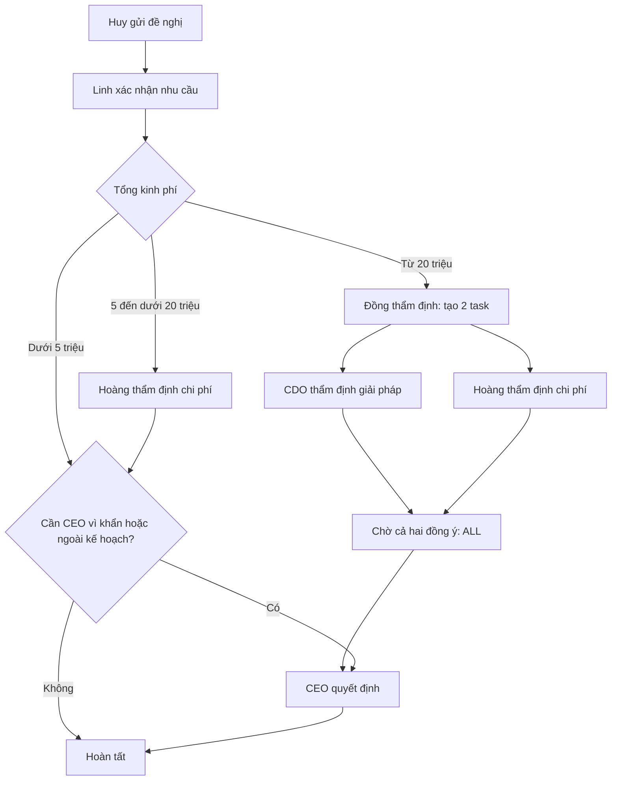

# Kịch bản trình bày: cấu hình và thực thi workflow động

Chuẩn bị ngày 13/10/2026. Mẫu **MS-BV-01 — Đề nghị mua sắm — quy trình trình bày**, tạo và ban hành bằng tài khoản CEO `ceo@flowpilot.vn`. Đây là chính sách minh họa của công ty demo, không phải quy định mua sắm bắt buộc cho mọi doanh nghiệp. Các hồ sơ và báo giá đều là dữ liệu giả lập.

## 1. Mục tiêu và thông điệp chính

**Câu giới thiệu đề xuất:**

> Em xây dựng hệ thống cho phép doanh nghiệp cấu hình quy trình phê duyệt theo biểu mẫu, cơ cấu tổ chức và dữ liệu hồ sơ. Khi chính sách thay đổi, người có quyền chỉnh cấu hình và ban hành phiên bản mới; bộ thực thi xử lý các hồ sơ theo phiên bản đã chốt và lưu lịch sử từng bước.

Trọng tâm trình bày: **cấu hình → kiểm tra/mô phỏng → ban hành → thực thi → theo dõi và giữ phiên bản**. Form mua sắm là tình huống chứng minh, không phải một quy trình được viết riêng vào engine.

### Mở đúng mẫu

Đăng nhập CEO → **Quy trình phê duyệt** → tìm **MS-BV-01** → **Mở quy trình**.

[Mở trực tiếp phần cấu hình](http://localhost:3000/workflows?form=0267e3b6-a7aa-4c81-8176-f1d433ce3fea)

[Xem mẫu A4 và các trường](http://localhost:3000/forms/0267e3b6-a7aa-4c81-8176-f1d433ce3fea)

Mẫu v1; workflow **v2** lúc chuẩn bị. v1 là quy trình một bước tự tạo khi CEO ban hành mẫu, v2 là quy trình nhiều bước đã cấu hình. Nếu em sửa và ban hành tiếp, số version sẽ tăng.

## 2. Biểu mẫu và vai trò

Trường chính: hạng mục, nhóm mua sắm, số lượng, ngày cần sử dụng, nhà cung cấp dự kiến, tổng kinh phí, nguồn kinh phí, căn cứ/lợi ích và checkbox xử lý khẩn. Có hai section để đọc A4 dễ hơn. Tổng kinh phí được nhập trực tiếp; hiện không tự tính từ số lượng × đơn giá. Ví dụ trình bày dùng số lượng/kinh phí dương.

| Tài khoản | Trách nhiệm trong demo |
|---|---|
| Huy — huy@flowpilot.vn | Người gửi thuộc nhóm Sản phẩm; tạo, bổ sung và gửi lại hồ sơ |
| Linh — linh@flowpilot.vn | Quản lý trực tiếp xác nhận nhu cầu |
| Hoàng — hoang@flowpilot.vn | Thẩm định chi phí và hiệu quả kinh doanh; tham gia đồng thẩm định |
| CDO — cdo@flowpilot.vn | Thẩm định giải pháp và tính phù hợp với định hướng chuyển đổi số |
| CEO — ceo@flowpilot.vn | Tạo/ban hành/chỉnh workflow, xem toàn công ty; quyết định bước cuối khi được giao |

Hoàng được cấp thêm role **PROCUREMENT_REVIEWER — Thẩm định mua sắm liên phòng ban**, scope ORGANIZATION, chỉ ba permission `REQUEST_APPROVE`, `REQUEST_REJECT`, `REQUEST_RETURN`. Role mới không cấp quản trị, sửa workflow hay `REQUEST_VIEW` toàn công ty. Người dùng vẫn chỉ xử lý task được giao, khác User người gửi. Quyền manager theo đơn vị ban đầu của Hoàng được giữ.

Role có scope toàn công ty để xử lý hồ sơ được giao từ phòng khác; hệ thống hiện chưa có scope permission riêng theo từng biểu mẫu. Việc áp role vào mẫu này nằm ở selector ROLE trong workflow. Không gọi Hoàng là CFO hoặc CDO là CTO vì đó không phải chức danh hiện có.

**CEO là người cấu hình mẫu, Huy là người gửi hồ sơ.** Hai trách nhiệm này khác nhau; CEO tạo mẫu không có nghĩa được tự duyệt yêu cầu do chính CEO gửi.

## 3. Chính sách và cấu hình từng bước

Các ngưỡng 5/20 triệu và SLA dưới đây là dữ liệu minh họa.

| Bước | Người được tìm theo cấu hình | Điều kiện chạy | Chính sách quyết định | SLA / nhắc trước |
|---|---|---|---|---|
| 01. Xác nhận nhu cầu | DIRECT_MANAGER của người gửi | Luôn chạy | ALL, một quản lý | 24 giờ / 2 giờ; có thể chuyển CDO khi quá hạn |
| 02. Thẩm định chi phí | ROLE = PROCUREMENT_REVIEWER | amount ≥ 5.000.000 **AND** amount < 20.000.000 | ALL | 8 giờ / 1 giờ; có thể chuyển CDO khi quá hạn |
| 03. Đồng thẩm định | POSITION = CDO ở công ty **và** ROLE = PROCUREMENT_REVIEWER | amount ≥ 20.000.000 | **ALL: cả CDO và Hoàng phải đồng ý** | 48 giờ / 4 giờ; ghi quá hạn, không tự chuyển cấp |
| 04. CEO quyết định | POSITION = CEO ở công ty | amount ≥ 20.000.000 **OR** urgent = true **OR** budgetSource = Chi ngoài kế hoạch | ALL, một CEO | 24 giờ / 2 giờ; ghi quá hạn |

### Phân biệt hai loại ALL/ANY

- **ALL/ANY của điều kiện:** AND/OR trên dữ liệu để quyết định có chạy bước không.
- **ALL/ANY của người duyệt:** cần tất cả/một người đồng ý để hoàn tất bước đã chạy.
- Ở bước 04, nhóm điều kiện ANY nghĩa là OR; chính sách phê duyệt vẫn ALL nhưng chỉ có một CEO. Ở bước 03, ALL là hai nhiệm vụ độc lập, được giao cùng thời điểm.

SLA tính liên tục 24/7 từ lúc bước bắt đầu, chưa trừ cuối tuần/ngày nghỉ. Đến hạn không tự đồng ý. Sửa SLA ở nháp không đổi hạn của hồ sơ v2 đã chạy.

### Tuyến nghiệp vụ



Sơ đồ trên thể hiện tuyến đồng ý. Mỗi task còn có từ chối và trả bổ sung; những kết quả đó kết thúc vòng/bước theo chính sách. Engine biểu diễn bằng danh sách bước có điều kiện, ghi SKIPPED khi không phù hợp; chưa phải bộ thực thi BPMN với đồ thị tùy ý.

## 4. Mô phỏng — phần nên trình bày kỹ nhất

Trong workflow của CEO, chọn **người gửi Trần Minh Huy**, nhập dữ liệu thử. Trường bắt buộc nên điền: hạng mục, nhóm mua sắm, số lượng, ngày, kinh phí, nguồn kinh phí, căn cứ. Urgent mặc định false. Đừng chọn CEO làm sender cho tuyến này vì CEO không có quản lý trực tiếp và không được tự duyệt.

| Dữ liệu | Các bước thực sự chạy | Ý nghĩa |
|---|---|---|
| 3 triệu, ngân sách bộ phận | 01 | Chi nhỏ do quản lý xác nhận |
| **Đúng 5 triệu** | 01 → 02 | Kiểm tra biên dưới bằng GTE |
| **19.999.999 đồng** | 01 → 02 | Biên trên bước 02 dùng LT |
| **Đúng 20 triệu** | 01 → 03 → 04 | Bỏ bước 02, mở đồng thẩm định rồi CEO |
| 35 triệu | 01 → 03 → 04 | Tuyến ngân sách lớn |
| 3 triệu + xử lý khẩn | 01 → 04 | Nhóm điều kiện OR tại bước CEO |
| 3 triệu + chi ngoài kế hoạch | 01 → 04 | Ngoại lệ nguồn kinh phí |

**Đã chạy qua API và đạt cả 7 tình huống** khi chuẩn bị. Kết quả người duyệt thực tế/kết quả từng bước ở [prepared.json](defense-demo/prepared.json). Simulation không tạo task, request hoặc quyết định; runtime gửi thật vẫn kiểm tra lại cơ cấu/quyền/ủy quyền đang hiệu lực.

## 5. Hồ sơ đã chuẩn bị

| Hồ sơ | Giá trị / trạng thái lúc chuẩn bị | Mở để trình bày |
|---|---|---|
| REQ-2026-00011 | 3 triệu · APPROVED | [Chi nhỏ, bước khác SKIPPED](http://localhost:3000/requests/12380335-fab3-485c-85a2-cc7b5f38e7c4) |
| REQ-2026-00012 | 12 triệu · APPROVED | [Duyệt tuần tự Linh → Hoàng](http://localhost:3000/requests/df18c8b5-0c70-4d51-ab08-9ce7b57ab15e) |
| **REQ-2026-00013** | **35 triệu · chờ CEO** | [Hồ sơ chính để CEO quyết định](http://localhost:3000/requests/5e8bc703-212c-4cd2-a379-5e4d9d7477d3) |
| REQ-2026-00014 | 9 triệu · RETURNED | [Lý do trả bổ sung và lịch sử](http://localhost:3000/requests/6fab55bb-f254-4e12-99d8-41cff1f75758) |
| DEMO-BV-05 | 35 triệu · DRAFT, chưa có mã | [Huy gửi trực tiếp khi trình bày](http://localhost:3000/requests/87b3b8b5-630f-45ab-937e-8a24886a5bbd) |

Mỗi hồ sơ có báo giá TXT mô phỏng. Với hồ sơ lớn, thầy đã cho Linh đồng ý, rồi CDO đồng ý trước và kiểm tra hồ sơ vẫn PENDING/CEO chưa được giao. Sau Hoàng đồng ý, task CEO mới xuất hiện. **Task CEO được để lại cho em thao tác khi trình bày.**

Các trạng thái có thể đổi khi em xử lý; thời hạn tiếp tục chạy theo đồng hồ thật. Nếu trình bày sau ngày chuẩn bị, dùng draft hoặc tạo một hồ sơ mới để có SLA mới. Không chỉnh timestamp/decision trực tiếp bằng Studio.

## 6. Kịch bản 8–10 phút

1. **30 giây — vấn đề:** doanh nghiệp có chính sách duyệt khác nhau; cần thay cấu hình mà không sửa engine.
2. **1 phút — mẫu:** mở form, chỉ ra amount/urgent/budgetSource là dữ liệu đầu vào của workflow; không dành nhiều thời gian bố cục A4.
3. **3 phút — cấu hình:** mở bốn thẻ bước; giải thích DIRECT_MANAGER, ROLE, POSITION; AND ở khoảng 5–<20 triệu; ALL đồng duyệt ở bước 03; OR ngoại lệ ở bước 04; SLA và permission.
4. **2 phút — mô phỏng:** chạy 3 triệu, 20 triệu và 3 triệu khẩn. Chỉ ra người duyệt, bước skip và kết quả điều kiện.
5. **2 phút — thực thi:** mở REQ-2026-00013, xem lịch sử hai người đồng thẩm định, CEO bấm đồng ý và xem hoàn tất. Đây là thao tác thật lên dữ liệu demo; sau đó hồ sơ không còn chờ CEO.
6. **1 phút — tính toàn vẹn:** chỉ v2 pin tại hồ sơ, lịch sử task, các vòng bổ sung và phân quyền; chọn một giới hạn/mở rộng phù hợp.

Nên dùng cửa sổ riêng cho Huy/Linh/Hoàng/CDO nếu trình bày toàn luồng gửi mới. Session cookie chung trong cùng browser khiến đổi tài khoản ảnh hưởng các tab khác. Trình bày ngắn chỉ cần CEO + hồ sơ đã chuẩn bị.

### Mở rộng: chứng minh đổi cấu hình và version

1. Giữ hồ sơ mới đang chạy v2. Nếu đã xử lý REQ-00013, dùng một hồ sơ khác; không chỉnh lại hồ sơ kết thúc.
2. CEO sửa ngưỡng lớn từ 20 lên 40 triệu: **đổi cả upper bound bước 02, GTE bước 03 và GTE đầu tiên bước 04**. Giữ hai điều kiện ngoại lệ. Đổi một chỗ có thể tạo khoảng không được thẩm định, nên phải mô phỏng biên 39.999.999/40.000.000.
3. Lưu nháp: tuyến ban hành v2 còn nguyên. Ban hành version mới: các hồ sơ đang chạy vẫn v2; hồ sơ gửi lần đầu sau ban hành dùng bản mới.
4. Với kinh phí 35 triệu bình thường, bản mới đi 01 → 02; bản cũ đi 01 → 03 → 04. Draft chưa gửi chưa pin version nên sẽ chọn bản mới lúc gửi.
5. Phục hồi version v2 vào nháp và ban hành tạo một version mới; lịch sử v2 không bị sửa.

### Mở rộng: bổ sung làm đổi tuyến

Huy mở REQ-00014, bổ sung căn cứ và đổi 9 thành 35 triệu, thêm version tài liệu nếu cần rồi gửi lại. Cùng mã, vòng 2, giữ workflow v2; chạy lại 01, bỏ 02 và đi 03 → 04. Quyết định vòng trước không tự được dùng lại.

## 7. Câu hỏi thường gặp của giáo viên

| Câu hỏi | Trả lời theo hệ thống hiện có |
|---|---|
| Có viết riêng luồng mua sắm trong backend không? | Definition JSON qua UI/API; evaluator/resolver và engine dùng chung. Script chỉ chuẩn bị dữ liệu/demo, không thêm nhánh `if mã mẫu mua sắm` vào engine. |
| Vì sao cần hai người cùng duyệt? | Hai trách nhiệm thẩm định độc lập; ALL cần đủ kết quả. Khi một người từ chối, bước/hồ sơ bị từ chối và task còn lại được hủy. |
| Hai người bấm đồng thời thì sao? | Request lock và transaction serialize quyết định; chỉ chuyển bước một lần. |
| Sửa workflow khi đơn đang chạy? | Instance pin workflow_version_id; draft/publish không đổi đơn cũ. |
| Hoàng khác phòng sao được duyệt? | Có role thẩm định liên phòng ban đúng scope, và được workflow giao task; không tự xem/duyệt hồ sơ bất kỳ. |
| CEO có tự duyệt đơn của mình? | User người gửi bị loại khi resolve/decide; tạo template khác với gửi request. |
| Không tìm được người duyệt? | Preflight lúc gửi thất bại thì rollback; thay đổi cơ cấu lúc chuyển bước có thể BLOCKED và cần khắc phục/retry. |
| Có BPMN hoặc AI không? | Hiện là mô hình bước cấu hình có điều kiện/song song/version; chưa BPMN tổng quát, chưa AI. |
| Hạn 24 giờ có trừ ngày nghỉ? | Chưa; hiện liên tục 24/7. Business calendar là phần mở rộng. |

## 8. Tên đề tài đề xuất

**Ưu tiên:** **Xây dựng hệ thống cấu hình và thực thi quy trình phê duyệt động cho doanh nghiệp.**

Tên này làm rõ đối tượng nghiệp vụ (phê duyệt), khả năng cấu hình và bộ thực thi, phù hợp trọng tâm muốn trình bày.

Các phương án khác:

1. **Xây dựng hệ thống phê duyệt nội bộ với quy trình động và biểu mẫu tùy chỉnh.** Rõ sản phẩm, cân bằng workflow/form.
2. **Xây dựng nền tảng thiết kế biểu mẫu và điều phối quy trình phê duyệt nội bộ.** Nhấn cả thiết kế biểu mẫu và runtime.
3. **Xây dựng hệ thống phê duyệt đa cấp và giám sát tiến độ xử lý cho doanh nghiệp.** Nhấn đa cấp/SLA/báo cáo, ít nhấn cấu hình hơn.

Đây là gợi ý để em trao đổi với giáo viên; tên đề tài chính thức trong tài liệu cũ chưa được đổi đồng loạt.

## 9. Chuẩn bị lại và bằng chứng

Từ `backend`, khi DB/API đang chạy:

```powershell
node scripts/prepare-defense-demo.mjs
```

Script dùng tài khoản CEO để tạo/ban hành và cấp role; role mới cần khởi tạo metadata bằng SQL vì API hiện chưa có endpoint tạo role tùy ý. Toàn bộ form/workflow/request/task chạy qua API thật. Script không ghi đè workflow đã được chỉnh riêng, không tự đặt lại quyết định hồ sơ có sẵn và không tạo trùng các case cùng nhãn. Nếu bạn clone một DB mới với seed demo, script tạo lại và cập nhật các ID trong prepared.json; các link cố định trong tài liệu này chỉ thuộc DB đã chuẩn bị ở máy em.

Mật khẩu đọc từ `.env`/shell; nếu tài khoản đã đổi mật khẩu có thể đặt riêng `DEMO_CEO_PASSWORD`, `DEMO_HUY_PASSWORD`, `DEMO_LINH_PASSWORD`, `DEMO_HOANG_PASSWORD`, `DEMO_CDO_PASSWORD`. Không lưu cookie/mật khẩu vào manifest.

- Mô phỏng đạt 7 tuyến; kiểm tra ngưỡng và ngoại lệ.
- Tạo 5 hồ sơ, 2 approved/1 pending CEO/1 returned/1 draft; kiểm tra ALL không giao CEO sớm, báo giá pin theo hồ sơ.
- **10 hồ sơ trước đó giữ nguyên** id/status/code/form_data; số lượng tăng do thêm dữ liệu demo, không xóa case cũ.
- Có backup trước chuẩn bị: `backups/pre-defense-demo-20261013.dump`, được Git ignore.
- Chưa có kiểm chứng browser/mobile/A4 trực quan trong lần chuẩn bị này. Sinh viên cần mở đúng tài khoản và thử kịch bản trước buổi trình bày.


## Chế độ sơ đồ flow mới

Mẫu MS-BV-01 có thể mở bằng **Sơ đồ flow**: chọn node để chỉnh bước trong panel, xem nhánh Đúng/Sai và nhóm đồng duyệt, chạy mô phỏng tô tuyến. Canvas và danh sách dùng chung bản nháp. Hướng dẫn tương tác và giới hạn: [WORKFLOW_CANVAS.md](WORKFLOW_CANVAS.md). Khi trình bày, bật toàn màn hình, chọn từng bước rồi mô phỏng 3/35 triệu.
