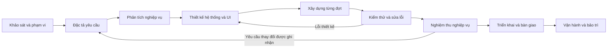
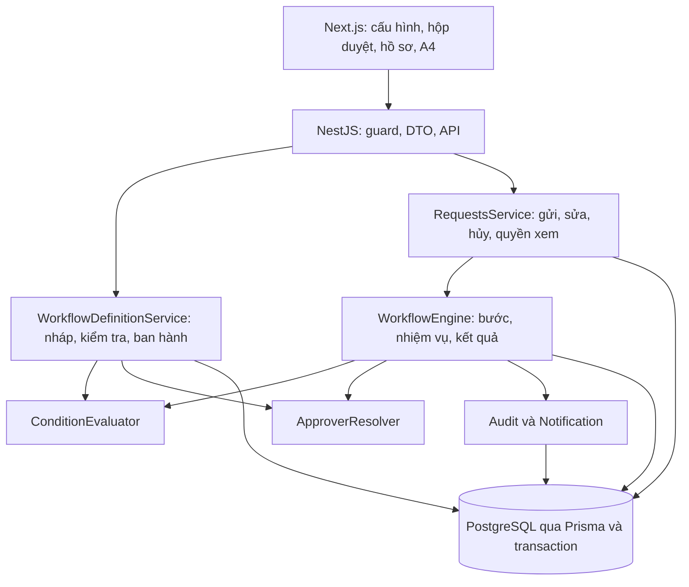
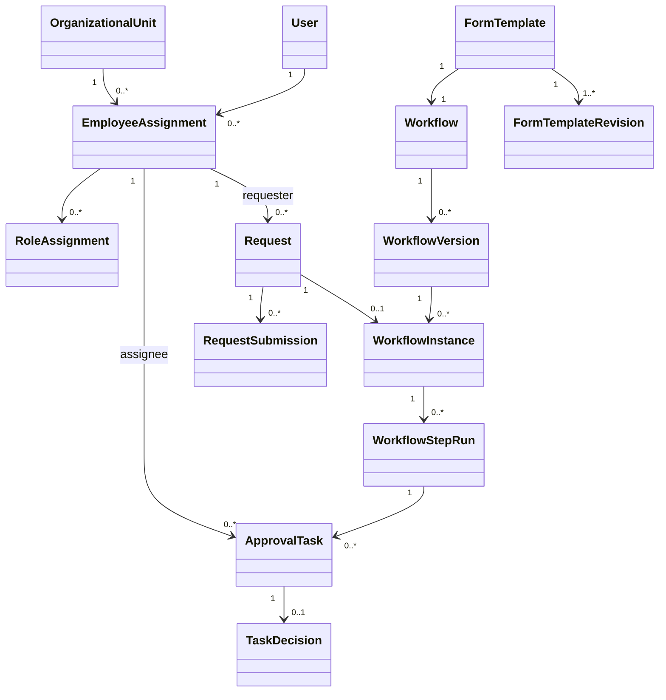
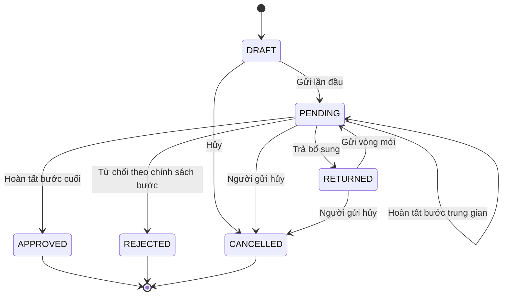
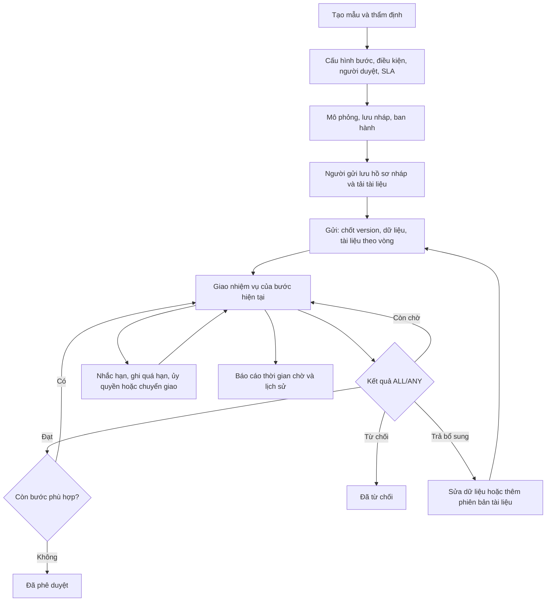

# Kế hoạch phát triển FlowPilot — Hệ thống quy trình phê duyệt nội bộ

> Tài liệu làm việc cho Tiểu luận chuyên ngành, học kỳ 1 năm 4.
> Mục đích: dùng làm căn cứ triển khai, theo dõi quyết định và ghi kết quả nghiệm thu qua từng bước.

| Thuộc tính | Giá trị |
|---|---|
| Phiên bản tài liệu | 1.0 |
| Ngày lập | 01/10/2026 |
| Thư mục dự án | `C:\Users\xiaomi\Study\Uni\Y4\TLCN\PrjectDemo` |
| Công nghệ | Next.js 16, NestJS 11, Prisma ORM 7, PostgreSQL 17, Docker Compose |
| Phiên bản phần mềm làm mốc | Commit `cf7c782`, tag `v0.1-baseline` |
| Trạng thái tài liệu | Đã lập kế hoạch; thiết kế trong tài liệu là phương án đề xuất để triển khai |
| Trạng thái sáu chức năng nâng cấp | Chưa triển khai, chưa nghiệm thu trong lần lập tài liệu này |
| Người triển khai | Sinh viên/nhóm phát triển; Codex hỗ trợ theo yêu cầu |
| Người xác nhận nghiệp vụ | Sinh viên đóng vai đại diện doanh nghiệp; giảng viên góp ý trong quá trình hướng dẫn |

## Cách dùng tài liệu

1. Đọc mục 1–4 để hiểu hiện trạng, phạm vi và các giai đoạn phát triển.
2. Dùng mục 5–10 làm đầu vào viết SRS, thiết kế dữ liệu, API, UI và code.
3. Thực hiện các đợt trong mục 11; mỗi đợt phải có phần chạy được và bằng chứng kiểm thử.
4. Dùng mục 12–14 để kiểm thử, triển khai và xử lý rủi ro.
5. Cập nhật sổ theo dõi ở mục 15 sau mỗi bước. Giữ lại các quyết định cũ bằng nhật ký thay đổi.

**Quy ước trạng thái:** `Đề xuất` → `Đã rà soát` → `Đã chốt để triển khai` → `Đã triển khai` → `Đã kiểm thử` → `Đã nghiệm thu`. Mỗi trạng thái phải có bằng chứng tương ứng. Một quyết định được đề xuất trong tài liệu không đồng nghĩa với xác nhận của giảng viên hoặc một chức năng đã chạy đúng.

**Quy ước mã:** `FR` = yêu cầu chức năng; `NFR` = yêu cầu chất lượng; `BR` = quy tắc nghiệp vụ; `ADR` = quyết định thiết kế; `TC` = ca kiểm thử; `G` = mốc kiểm tra; `CR` = yêu cầu thay đổi.

## Mục lục

- [1. Hiện trạng và khoảng cách cần giải quyết](#1-hiện-trạng-và-khoảng-cách-cần-giải-quyết)
- [2. Mục tiêu, phạm vi và giá trị học thuật](#2-mục-tiêu-phạm-vi-và-giá-trị-học-thuật)
- [3. Quy trình phát triển và cách chốt kết quả](#3-quy-trình-phát-triển-và-cách-chốt-kết-quả)
- [4. Công việc, đầu ra và tiêu chí của từng bước](#4-công-việc-đầu-ra-và-tiêu-chí-của-từng-bước)
- [5. Đặc tả sáu chức năng ưu tiên](#5-đặc-tả-sáu-chức-năng-ưu-tiên)
- [6. Quy tắc nghiệp vụ và quyết định thiết kế](#6-quy-tắc-nghiệp-vụ-và-quyết-định-thiết-kế)
- [7. Kiến trúc và mô hình dữ liệu dự kiến](#7-kiến-trúc-và-mô-hình-dữ-liệu-dự-kiến)
- [8. Phân quyền dự kiến](#8-phân-quyền-dự-kiến)
- [9. Hợp đồng API và điểm tích hợp](#9-hợp-đồng-api-và-điểm-tích-hợp)
- [10. Kế hoạch UI/UX](#10-kế-hoạch-uiux)
- [11. Thứ tự triển khai và mốc bàn giao](#11-thứ-tự-triển-khai-và-mốc-bàn-giao)
- [12. Kiểm thử và truy vết yêu cầu](#12-kiểm-thử-và-truy-vết-yêu-cầu)
- [13. Migration, triển khai và phục hồi](#13-migration-triển-khai-và-phục-hồi)
- [14. Rủi ro và quản lý thay đổi](#14-rủi-ro-và-quản-lý-thay-đổi)
- [15. Sổ theo dõi kết quả chốt từng bước](#15-sổ-theo-dõi-kết-quả-chốt-từng-bước)
- [16. Tài liệu tham khảo](#16-tài-liệu-tham-khảo)

## 1. Hiện trạng và khoảng cách cần giải quyết

### 1.1. Căn cứ khảo sát

Đã đọc source, schema Prisma, SQL migration `001`–`004`, bộ kiểm thử và tài liệu trong repository ngày 01/10/2026. Git đang ở commit `cf7c782` và không có thay đổi chưa commit trước khi viết kế hoạch. Lần khảo sát này không chạy lại build, kiểm thử tích hợp hoặc nghiệm thu trình duyệt.

| Thành phần | Hiện trạng xác định từ source/tài liệu | Căn cứ |
|---|---|---|
| Đăng ký, đăng nhập | Tài khoản mới chờ kích hoạt; phiên lưu DB; quyền được kiểm tra lại tại API | `backend/server/auth.ts` |
| Tổ chức và nhân sự | Công ty, phòng ban, team, chức danh, phân công, quản lý trực tiếp, vai trò có phạm vi/thời hạn | `backend/prisma/schema.prisma`, `backend/server/admin.ts` |
| Công ty mẫu | 8 tài khoản: CEO, CDO, 2 trưởng phòng, 4 nhân viên; CTO có trong danh mục chức danh | `README.md`, seed và kiểm thử |
| Thiết kế mẫu | Trường động, bố cục A4, đề xuất/thẩm định, lãnh đạo ban hành trực tiếp | `backend/server/forms.ts`, `docs/PERMISSIONS.md` |
| Lịch sử mẫu | Phiên bản mẫu và bản lưu nội dung mẫu trên từng đơn | Migration `004_template_permissions.sql` |
| Quy trình yêu cầu | Một người duyệt, được chọn theo quản lý trực tiếp hoặc chức danh | `backend/server/requests.ts`, bảng `workflows` |
| Gửi và quyết định | Transaction, khóa hàng; duyệt/từ chối; không tự duyệt; nhận xét khi từ chối | `backend/server/requests.ts` |
| Trả yêu cầu để bổ sung | Chưa có vòng trả đơn và gửi lại trên cùng hồ sơ; đang có sao chép đơn bị từ chối | `backend/server/requests.ts`, `docs/API.md` |
| Hạ tầng | Docker Compose, PostgreSQL volume, Prisma Studio, database tạm cho kiểm thử | `compose.yaml`, `backend/tests/run.mjs` |

### 1.2. Khoảng cách chính

- Quy trình hiện tại mới thể hiện một lượt quyết định; chưa có tiến trình nhiều bước và nhiệm vụ độc lập cho mỗi người duyệt.
- Chưa điều hướng theo dữ liệu, chưa thể chạy duyệt song song với quy tắc kết hợp kết quả.
- Chưa quản lý phiên bản định nghĩa quy trình và phiên thực thi tương ứng.
- Chưa có lịch sử các vòng bổ sung dữ liệu trên cùng mã đơn.
- Giao diện đang mô tả một người duyệt; cần mô tả bước hiện tại, các nhiệm vụ và tiến độ toàn quy trình.
- Tài liệu có nội dung cũ: `ARCHITECTURE.md`, `API.md`, `TESTING.md` còn mô tả hạn chế quyền của Executive, bất biến mẫu hoặc 54 kiểm tra; README và source đã có thay đổi mới. Phải đồng bộ trước khi bàn giao.
- Class diagram tại `../Document/ClassDiagram_TLCN.puml` sử dụng mô hình User/Department cũ. Cần đối chiếu với mô hình User–EmployeeAssignment–OrganizationalUnit của ứng dụng.

**Kết luận khảo sát:** giữ nền tảng tài khoản, tổ chức, biểu mẫu và hạ tầng; bổ sung bộ xử lý quy trình cùng mô hình nhiệm vụ, phiên bản và vòng gửi. Đánh giá đạt yêu cầu học phần còn phụ thuộc rubric và ý kiến giảng viên; chưa có rubric trong dữ liệu khảo sát.

## 2. Mục tiêu, phạm vi và giá trị học thuật

### 2.1. Tên đề tài đề xuất

**Xây dựng hệ thống quản lý quy trình phê duyệt nội bộ với biểu mẫu động và quy trình cấu hình theo dữ liệu.**

### 2.2. Mục tiêu đo được

| Mã | Mục tiêu | Bằng chứng hoàn thành |
|---|---|---|
| OBJ-01 | Người quản trị cấu hình quy trình nhiều bước từ UI | Tạo, lưu nháp, ban hành và dùng quy trình qua giao diện |
| OBJ-02 | Hệ thống điều hướng theo giá trị trên đơn | Hai đơn cùng mẫu, khác số tiền, có đường xử lý đúng quy tắc |
| OBJ-03 | Hỗ trợ nhóm duyệt ALL và ANY | Kết quả kiểm thử nhiều người và xử lý đồng thời |
| OBJ-04 | Xác định người duyệt theo tổ chức và quyền thực tế | Mô phỏng phân công; kiểm thử phạm vi, hiệu lực và cấm tự duyệt |
| OBJ-05 | Đơn đang chạy giữ quy trình đã chốt | So sánh đơn chạy v1 với đơn mới chạy v2 sau ban hành |
| OBJ-06 | Trả bổ sung và gửi lại trên cùng hồ sơ | Giữ mã đơn; xem được dữ liệu, góp ý, quyết định của các vòng |
| OBJ-07 | Có hồ sơ kỹ thuật truy vết từ yêu cầu đến kiểm thử | SRS, sơ đồ, API, bảng FR–TC, báo cáo test và hướng dẫn demo |

### 2.3. Phạm vi lần nâng cấp

**Bắt buộc:** sáu chức năng FR-01 đến FR-06; phân quyền tương ứng; UI cấu hình và theo dõi; migration từ bản cũ; dữ liệu demo; kiểm thử; đồng bộ SRS/class diagram/ERD/tài liệu.

**Hỗ trợ bắt buộc để dùng được:** kiểm tra hợp lệ trước ban hành, mô phỏng với dữ liệu mẫu, thông báo nhiệm vụ mới, lịch sử thực thi, xử lý lỗi thiếu người duyệt và kiểm soát chỉnh sửa đồng thời.

**Để sau đợt này:** SLA/nhắc hạn, ủy quyền/chuyển giao nhiệm vụ, tệp đính kèm, email/SMS, SSO, chữ ký số, nhiều doanh nghiệp và bộ thiết kế BPMN tổng quát. Ghi vào backlog riêng nếu có thời gian; không tính là điều kiện hoàn thành sáu chức năng.

### 2.4. Nội dung kỹ thuật có thể trình bày khi bảo vệ

- Tách định nghĩa quy trình, phiên bản ban hành và phiên thực thi.
- Mô hình hóa trạng thái hồ sơ, bước và nhiệm vụ; chứng minh các chuyển trạng thái hợp lệ.
- Đánh giá điều kiện có kiểu dữ liệu và xác định người duyệt theo cây tổ chức.
- Kết hợp kết quả song song và xử lý tranh chấp bằng transaction/khóa hàng.
- Bảo toàn lịch sử khi thay quy trình, sửa mẫu và bổ sung đơn.
- Kiểm thử truy vết, phân quyền tại API và nâng cấp dữ liệu cũ.

## 3. Quy trình phát triển và cách chốt kết quả

### 3.1. Mô hình áp dụng

Áp dụng **phát triển lặp và tăng trưởng**, chia thành các đợt có chức năng chạy được. Trong mỗi đợt thực hiện: làm rõ yêu cầu → thiết kế → xây dựng → kiểm thử → nghiệm thu → cập nhật tài liệu.

Khung quy trình tham khảo [ISO/IEC/IEEE 12207:2026](https://www.iso.org/standard/90219.html), tiêu chuẩn về các quá trình vòng đời phần mềm, cho phép áp dụng theo cách lặp và tăng trưởng. Các nhóm công việc yêu cầu, thiết kế, xây dựng, kiểm thử, quản lý cấu hình và chất lượng được tham khảo từ [SWEBOK của IEEE Computer Society](https://www.computer.org/education/bodies-of-knowledge/software-engineering). Cách chia đợt và các mốc G bên dưới là điều chỉnh cho dự án sinh viên; chưa phải tuyên bố chứng nhận tuân thủ tiêu chuẩn.



### 3.2. Quy định mốc kiểm tra

- Một mốc G chỉ `Đạt` khi đầu ra tồn tại, đã được rà soát và có bằng chứng cho tiêu chí thoát.
- Có thể chuẩn bị công việc giai đoạn sau song song; triển khai phụ thuộc chỉ bắt đầu khi quyết định liên quan đã ổn định.
- Nếu chưa đạt: ghi phần thiếu, người xử lý, cách sửa và thời điểm đánh giá lại.
- Người phát triển tự kiểm tra kỹ thuật; sinh viên xác nhận kịch bản nghiệp vụ. Góp ý giảng viên được ghi riêng khi thực sự nhận được.
- Kết quả build/test, số ca đạt, thời gian đáp ứng và commit phải lấy từ lần chạy thực tế.

### 3.3. Bảng tổng quan các bước

| Bước | Nội dung | Đầu ra chính | Mốc |
|---|---|---|---|
| 0 | Khảo sát và lưu mốc | Báo cáo hiện trạng, commit/tag, danh sách sai lệch tài liệu | G0 |
| 1 | Xác định phạm vi và kế hoạch | Phạm vi, mục tiêu, backlog, rủi ro, lịch dự kiến | G1 |
| 2 | Đặc tả yêu cầu | SRS, FR/NFR/BR, use case, tiêu chí nghiệm thu | G2 |
| 3 | Phân tích nghiệp vụ | Activity/state/sequence diagram, quy tắc tổ chức/quyền | G3 |
| 4 | Thiết kế kiến trúc và dữ liệu | Thiết kế kỹ thuật, ERD/class diagram, API, migration | G4 |
| 5 | Thiết kế và kiểm tra UI/UX | Luồng màn hình, prototype, checklist khả dụng | G5 |
| 6 | Xây dựng và tích hợp | Code, schema, migration, seed, chức năng từng đợt | G6 theo đợt |
| 7 | Kiểm thử hệ thống | Test case, kết quả tự động/thủ công, lỗi và retest | G7 |
| 8 | Nghiệm thu và chuẩn bị demo | Biên bản UAT, kịch bản demo, release candidate | G8 |
| 9 | Triển khai và bàn giao | Bản phát hành, runbook, báo cáo, bằng chứng phục hồi | G9 |

## 4. Công việc, đầu ra và tiêu chí của từng bước

### Bước 0 — Khảo sát, xác định phiên bản xuất phát

**Đầu vào:** repository, source, tài liệu cũ và yêu cầu của sinh viên.

**Công việc:**

1. Xác nhận commit/tag xuất phát và trạng thái Git.
2. Liệt kê chức năng hiện có; phân biệt code đang có với nội dung tài liệu.
3. Chạy lại build và bộ kiểm thử nền khi bắt đầu triển khai để có kết quả xuất phát.
4. Ghi dữ liệu mẫu và các trường hợp đơn DRAFT/PENDING/final cần giữ khi nâng cấp.
5. Lập bảng tài liệu lỗi thời và phần schema/trigger sẽ bị tác động.

**Đầu ra:** mục 1 của tài liệu này; bổ sung `docs/baseline-report.md` khi có kết quả chạy thực tế.

**Kết quả cần chốt:** phiên bản xuất phát, chức năng giữ lại, lỗi nền cần sửa, danh sách dữ liệu cần bảo toàn.

**G0 đạt khi:** đọc được bản mốc, build/test nền có kết quả hoặc lỗi được phân loại; không có thay đổi người khác bị ghi đè. Khảo sát source hiện đã làm; build/test mới đang chờ.

### Bước 1 — Chốt mục tiêu, phạm vi và kế hoạch

**Đầu vào:** kết quả G0, sáu ưu tiên của sinh viên, thời gian học phần.

**Công việc:** xác định người dùng; lập phạm vi bắt buộc/để sau; chia đợt; ước lượng; đặt tiêu chí thành công và trách nhiệm rà soát.

**Đầu ra:** tài liệu này và backlog có mã công việc.

**Kết quả cần chốt:** sáu ưu tiên, cách chia đợt, mục tiêu đo được, phương án lịch học thực tế. Thời lượng ở mục 11 là ước lượng, chưa là lịch cam kết.

**G1 đạt khi:** mọi mục bắt buộc có mục tiêu, đầu ra và cách kiểm tra; không có hạng mục mơ hồ như “làm workflow đầy đủ” mà thiếu đặc tả.

### Bước 2 — Đặc tả yêu cầu phần mềm

**Đầu vào:** phạm vi G1, kịch bản công ty mẫu, mô hình biểu mẫu hiện tại.

**Công việc:**

1. Viết SRS gồm ngữ cảnh, tác nhân, chức năng, dữ liệu, quy tắc, NFR và giới hạn.
2. Với từng FR: ghi điều kiện trước, luồng chính, luồng thay thế, lỗi, kết quả sau và tiêu chí chấp nhận.
3. Chốt các câu hỏi: ALL/ANY kết hợp thế nào; trả đơn khác từ chối thế nào; gửi lại duyệt từ đâu; thiếu người duyệt xử lý thế nào.
4. Tách phiên bản biểu mẫu khỏi phiên bản quy trình và vòng gửi.
5. Gắn yêu cầu với ca kiểm thử dự kiến ngay từ bước này.

**Đầu ra dự kiến:** `docs/SRS.md`, bảng FR/NFR/BR, ma trận truy vết ở mục 12.

**Kết quả cần chốt:** SRS phiên bản 1.0; các quy tắc BR đã rà soát; kịch bản thử đủ cho FR-01–06.

**G2 đạt khi:** mỗi yêu cầu bắt buộc có ít nhất một tiêu chí đo/quan sát được; tình huống lỗi và các quyết định quan trọng không còn mâu thuẫn.

### Bước 3 — Phân tích nghiệp vụ và trạng thái

**Đầu vào:** SRS đã ổn định.

**Công việc:**

1. Vẽ use case cho nhân viên, trưởng phòng, lãnh đạo ban hành, quản trị viên.
2. Vẽ activity diagram gửi đơn → xác định bước → giao nhiệm vụ → quyết định → chuyển bước/kết thúc.
3. Vẽ state diagram riêng cho Request, WorkflowInstance, StepRun và ApprovalTask.
4. Vẽ sequence diagram gửi đơn; hai người quyết định đồng thời; trả bổ sung và gửi lại.
5. Walkthrough bằng dữ liệu Huy → Linh → CDO/CEO để kiểm tra tính đúng của quyền và đường xử lý.

**Đầu ra dự kiến:** `docs/diagrams/` chứa source Mermaid/PlantUML và bản xuất xem được; `docs/business-rules.md`.

**Kết quả cần chốt:** thứ tự thực thi; mọi chuyển trạng thái; chính sách nhóm duyệt; cách nhận diện người được giao; cách khôi phục tình huống chặn.

**G3 đạt khi:** đi qua được các ca thành công, từ chối, trả bổ sung, hủy, thiếu người duyệt và xung đột; không có vòng lặp thực thi không giới hạn hoặc đường tự duyệt.

### Bước 4 — Thiết kế kỹ thuật, dữ liệu và migration

**Đầu vào:** SRS, sơ đồ nghiệp vụ, source hiện tại.

**Công việc:**

1. Thiết kế WorkflowEngine, evaluator, resolver và ranh giới transaction.
2. Chốt bảng, khóa ngoại, unique/check constraint, index và dữ liệu bất biến.
3. Định nghĩa JSON cấu hình có schema version; giới hạn cấu hình; quy tắc tương thích mẫu.
4. Thiết kế API, DTO, mã lỗi, revision và chống thao tác lặp.
5. Thiết kế migration `005`, backfill workflow một bước và hồ sơ đang chạy.
6. Đồng bộ Prisma schema; định nghĩa phép kiểm chứng SQL–Prisma–diagram.
7. Lập phương án sao lưu, thử migration và phục hồi.

**Đầu ra dự kiến:** `docs/technical-design.md`, `docs/data-model.md`, `docs/ADR.md`, API cập nhật, ERD, class diagram, migration được rà soát.

**Kết quả cần chốt:** mô hình thực thi; bất biến dữ liệu; chiến lược version/snapshot; khóa xử lý song song; cách giữ dữ liệu cũ.

**G4 đạt khi:** thực thể/quan hệ thống nhất giữa thiết kế và Prisma dự kiến; transaction có bước rollback; migration có phép đối chiếu số lượng và lịch sử; API đủ cho tất cả luồng UI.

### Bước 5 — Thiết kế UI/UX và prototype

**Đầu vào:** use case, API, trạng thái và design system hiện tại.

**Công việc:** dùng skill `ui-ux-pro-max` khi thực hiện thiết kế; dựng luồng màn hình; prototype trình cấu hình, mô phỏng, chi tiết đơn, hộp duyệt và bổ sung; kiểm tra bằng bàn phím và viewport nhỏ.

**Đầu ra dự kiến:** cập nhật `docs/UI-UX.md`; prototype có dữ liệu giả được ghi rõ; danh sách màn hình và kết quả kiểm tra khả dụng.

**Kết quả cần chốt:** người dùng nhận biết được nháp/ban hành; cấu hình ALL/ANY và điều kiện không nhầm; biết ai đang xử lý, vì sao bỏ qua bước và góp ý cần bổ sung.

**G5 đạt khi:** các hành động chính thực hiện được qua prototype; có loading/empty/error/permission state; không phụ thuộc kéo thả để thao tác; nội dung tiếng Việt rõ nghĩa.

### Bước 6 — Xây dựng từng đợt và tích hợp

**Đầu vào:** thiết kế đã rà soát, backlog, ca kiểm thử.

**Công việc trong mỗi đợt:**

1. Tạo nhánh làm việc từ bản mốc, ví dụ `feat/workflow-core`.
2. Thực hiện schema/migration → logic miền → API/quyền → UI → seed demo.
3. Viết kiểm thử quy tắc có rủi ro; chạy regression bị tác động.
4. Rà soát diff về quyền, transaction, query và lỗi.
5. Commit phần chạy được; ghi kết quả và vấn đề còn lại vào sổ theo dõi.

**Đầu ra:** phần mềm có thể chạy qua Docker, code, migration, Prisma Client, test và tài liệu cập nhật theo đợt.

**Kết quả cần chốt:** phạm vi đã chạy thực tế; commit; FR/TC liên quan; lỗi chưa xử lý. Không đánh dấu hoàn thành chỉ vì nút đã xuất hiện trên UI.

**G6 của một đợt đạt khi:** backend/frontend build được; API kiểm tra quyền; test bắt buộc của đợt đạt; demo được từ đầu đến cuối; không phá luồng đã nghiệm thu.

### Bước 7 — Kiểm thử hệ thống và sửa lỗi

**Đầu vào:** bản tích hợp, test case, dữ liệu thử, môi trường ghi rõ.

**Công việc:** chạy unit/integration/concurrency/migration/security/UI theo mục 12; ghi actual result; phân loại lỗi; sửa và retest; chạy regression liên quan sau sửa.

**Đầu ra dự kiến:** `docs/test-cases.md`, `docs/test-report.md`, log kiểm thử, ảnh UI/A4 và defect log.

**Kết quả cần chốt:** số ca chạy/đạt/trượt/chưa chạy; bằng chứng tính đúng; lỗi còn lại và ảnh hưởng. Báo cáo tách kiểm thử tự động API khỏi kiểm tra UI thủ công.

**G7 đạt khi:** toàn bộ ca bắt buộc đạt; không còn lỗi làm sai quyết định, mất lịch sử hoặc vượt quyền; migration đã được thử với dữ liệu cũ; NFR đo được có kết quả.

### Bước 8 — Nghiệm thu nghiệp vụ và chuẩn bị bảo vệ

**Đầu vào:** release candidate qua G7, kịch bản demo và tài liệu.

**Công việc:** sinh viên thử theo từng vai trò; chạy các kịch bản ở mục 12.4; đối chiếu OBJ/FR; ghi góp ý; chỉnh lỗi; chốt bộ dữ liệu và trình tự trình bày.

**Đầu ra dự kiến:** `docs/UAT.md`, `docs/DEMO.md`, danh sách hạn chế thực tế, release candidate được gắn commit.

**Kết quả cần chốt:** sáu chức năng đã được xác nhận; giới hạn chấp nhận được; kết quả UAT; phần cần hỏi giảng viên khi có rubric/góp ý.

**G8 đạt khi:** sinh viên thực hiện được các luồng theo hướng dẫn; kết quả giống đặc tả; code, diagram và lời trình bày dùng cùng mô hình.

### Bước 9 — Triển khai, bàn giao và bảo trì

**Đầu vào:** bản đã nghiệm thu và bản sao lưu.

**Công việc:** chạy migration/build theo runbook; kiểm tra health và smoke test; thử clone trên môi trường sạch; xem bản ghi bằng Prisma Studio; kiểm tra phục hồi; cập nhật README và báo cáo cuối.

**Đầu ra dự kiến:** tag phát hành, `docs/OPERATIONS.md`, bộ tài liệu hoàn chỉnh, ghi chú phát hành, hướng dẫn tiếp tục phát triển.

**Kết quả cần chốt:** commit/tag phát hành, cách chạy lại, bằng chứng migrate/restore, giới hạn còn lại và người tiếp nhận.

**G9 đạt khi:** bạn khác clone và chạy được theo README; dữ liệu cũ được giữ; có cách phục hồi đã thử; tài liệu không ghi chức năng chưa triển khai là đã có.

## 5. Đặc tả sáu chức năng ưu tiên

### FR-01 — Phê duyệt nhiều cấp tuần tự

**Người dùng:** lãnh đạo cấu hình; nhân viên gửi; người duyệt xử lý.

**Luồng chính:** tạo các bước có thứ tự → ban hành → gửi đơn → tạo nhiệm vụ của bước đầu → hoàn tất bước → giao bước tiếp → kết thúc khi mọi bước cần chạy đã đạt.

**Tiêu chí chấp nhận:**

- AC-01.1: cấu hình ít nhất ba bước và thay đổi thứ tự được; tên và ID bước ổn định trong phiên bản ban hành.
- AC-01.2: người ở bước sau chưa có nhiệm vụ hiệu lực và không thể duyệt sớm qua API.
- AC-01.3: hoàn tất một bước trung gian giữ đơn `PENDING`; chỉ bước cuối hoàn tất mới làm đơn `APPROVED`.
- AC-01.4: từ chối theo chính sách bước làm đơn `REJECTED`, dừng phần còn lại và thông báo người gửi.
- AC-01.5: chi tiết đơn hiển thị bước đã qua, hiện tại, tiếp theo và lịch sử người xử lý.

**Ngoại lệ:** không giải quyết được người duyệt; người duyệt mất quyền; hủy trong lúc quyết định. Xử lý theo BR-12 và BR-13.

### FR-02 — Điều kiện và rẽ nhánh theo dữ liệu

**Thiết kế đề xuất:** mỗi bước có điều kiện chạy, ghép các điều kiện bằng `ALL` (AND) hoặc `ANY` (OR). Điều kiện đúng thì chạy; sai thì lưu kết quả `SKIPPED` và xét bước tiếp theo. Hai bước có điều kiện loại trừ nhau tạo nhánh nghiệp vụ.

**Tiêu chí chấp nhận:**

- AC-02.1: chọn trường có trong mẫu và toán tử phù hợp kiểu; không cho nhập mã JavaScript/SQL để thực thi.
- AC-02.2: số hỗ trợ `EQ`, `NE`, `GT`, `GTE`, `LT`, `LTE`; văn bản/danh sách hỗ trợ `EQ`, `NE`, `IN`; ngày hỗ trợ so sánh ngày; checkbox hỗ trợ `EQ` với boolean.
- AC-02.3: giá trị rỗng hoặc thiếu làm điều kiện so sánh trả `false`; dùng `IS_EMPTY`/`IS_NOT_EMPTY` khi cần kiểm tra rỗng. `0` và `false` không bị coi là rỗng.
- AC-02.4: các ngưỡng như 10.000.000 được kiểm thử nhỏ hơn, bằng và lớn hơn; ngày chuẩn hóa theo ngày lịch `YYYY-MM-DD`.
- AC-02.5: mô phỏng và thực thi dùng cùng evaluator; lịch sử ghi dữ liệu vòng gửi, biểu thức và kết quả đánh giá.
- AC-02.6: bước đầu bắt buộc vô điều kiện, có người duyệt; cấu hình không thể để hồ sơ được thông qua vì toàn bộ bước bị bỏ qua.

**Giới hạn phiên bản đầu:** danh sách bước có điều kiện, không có chu trình; không yêu cầu nhánh tùy ý quay lại bước cũ. Nếu muốn mở rộng thành đồ thị/BPMN, cần CR cùng thiết kế mới.

### FR-03 — Phê duyệt song song ALL/ANY

**Luồng chính:** bước có nhiều người → tạo nhiệm vụ cùng lúc → mỗi người xử lý nhiệm vụ của mình → bộ xử lý kết hợp kết quả → chuyển bước hoặc kết thúc.

| Chính sách | Điều kiện đạt bước | Điều kiện từ chối bước | Nhiệm vụ còn chờ |
|---|---|---|---|
| ALL | Mọi nhiệm vụ đều APPROVED | Một nhiệm vụ REJECTED | Hủy khi bước bị từ chối/trả đơn/hồ sơ hủy |
| ANY | Một nhiệm vụ APPROVED | Tất cả nhiệm vụ REJECTED | Hủy ngay khi đã có kết quả đạt |

**Tiêu chí chấp nhận:**

- AC-03.1: hộp duyệt hiển thị mọi người được giao và chính sách ALL/ANY.
- AC-03.2: người đã xử lý không thể quyết định nhiệm vụ lần thứ hai.
- AC-03.3: hai quyết định đồng thời chỉ chuyển bước một lần; không sinh nhiệm vụ/thông báo trùng.
- AC-03.4: ANY có một từ chối vẫn chờ người còn lại; một đồng ý hoàn tất bước.
- AC-03.5: yêu cầu bổ sung từ một nhiệm vụ còn chờ dừng cả vòng xử lý và hủy nhiệm vụ còn chờ; quyết định đã ghi được giữ trong lịch sử.
- AC-03.6: loại trùng cùng một User trong cùng bước, kể cả có nhiều phân công; cách chọn phân công được xác định theo BR-05.

### FR-04 — Xác định người duyệt linh hoạt

| Loại | Ý nghĩa | Cách xử lý mơ hồ |
|---|---|---|
| DIRECT_MANAGER | Quản lý trực tiếp của phân công người gửi | Thiếu quản lý: báo lỗi |
| MANAGER_LEVEL | Cấp thứ N trong chuỗi quản lý của người gửi | Thiếu cấp/chu trình: báo lỗi |
| POSITION | Chức danh, có thể giới hạn theo đơn vị đã chọn | Phải đúng một ứng viên hợp lệ; nhiều người: yêu cầu thêm phạm vi |
| ASSIGNMENT | Một phân công cụ thể của nhân sự | Kiểm tra lại hiệu lực và quyền khi giao |
| ROLE | Các phân công giữ vai trò đã chọn, trong phạm vi quy tắc | Tạo nhóm nhiệm vụ; dedup User |
| UNIT_HEAD | Người đứng đầu đơn vị chỉ định hoặc đơn vị gần nhất của người gửi có head | Phải có đúng một head hợp lệ tại đơn vị được chọn |

**Tiêu chí chấp nhận:**

- AC-04.1: ứng viên có User/đơn vị/chức danh/phân công đang hoạt động và đủ quyền duyệt trong phạm vi đơn.
- AC-04.2: cấm người cùng User với người gửi, kể cả duyệt qua phân công khác.
- AC-04.3: không tự suy ra quyền từ chức danh CEO/CDO/CTO; API dùng vai trò và permission.
- AC-04.4: kết quả resolver rõ ràng; không chọn người đầu tiên ngẫu nhiên khi có nhiều ứng viên.
- AC-04.5: mô phỏng hiển thị tên/chức danh/đơn vị và lý do thiếu ứng viên cho người có quyền cấu hình.
- AC-04.6: người được giao được chốt khi bước bắt đầu; thay quản lý sau đó không tự chuyển nhiệm vụ.

### FR-05 — Nháp, ban hành và phiên bản quy trình

**Luồng chính:** mở quy trình → sửa nháp → kiểm tra/mô phỏng → ban hành phiên bản mới → đơn gửi mới dùng phiên bản đang ban hành; đơn đang chạy giữ phiên bản đã chốt.

**Tiêu chí chấp nhận:**

- AC-05.1: lưu nháp không thay cấu hình đang dùng; UI hiển thị cả draft revision và published version.
- AC-05.2: ban hành kiểm tra cấu hình, tham chiếu trường và người/nhóm tĩnh; phiên bản tăng tuần tự, có người và thời điểm ban hành.
- AC-05.3: bản đã ban hành không sửa/xóa; thay đổi tạo bản mới.
- AC-05.4: gửi lần đầu chốt `workflow_version_id`; gửi lại sau trả bổ sung vẫn giữ ID này.
- AC-05.5: mở được lịch sử và diff thay đổi bước/điều kiện/người duyệt; khôi phục cấu hình cũ bằng một phiên bản ban hành mới.
- AC-05.6: hai người sửa cùng draft revision không ghi đè nhau; bản cũ nhận `409` và có cách tải lại/so sánh.
- AC-05.7: phiên bản quy trình tham chiếu phiên bản mẫu lúc ban hành. Đơn nháp giữ mẫu cũ mà không tương thích phiên bản quy trình hiện hành nhận lỗi cụ thể; hướng dẫn tạo đơn mới từ mẫu hiện hành.

### FR-06 — Trả bổ sung, chỉnh sửa và gửi lại

**Luồng chính:** người duyệt nhập góp ý → trả đơn → người gửi mở hồ sơ → sửa dữ liệu → gửi lại → hệ thống tạo vòng gửi mới và chạy lại từ đầu theo phiên bản quy trình đã chốt.

**Tiêu chí chấp nhận:**

- AC-06.1: `RETURNED` khác `REJECTED`; bắt buộc góp ý khi trả hoặc từ chối.
- AC-06.2: chỉ người gửi đúng phân công và còn quyền được sửa đơn `RETURNED`; người duyệt không sửa dữ liệu đơn thay người gửi.
- AC-06.3: giữ mã đơn, người gửi, phiên bản mẫu, phiên bản quy trình và thời điểm gửi đầu tiên.
- AC-06.4: mỗi lần gửi lưu snapshot dữ liệu, số vòng, thời điểm; mỗi nhiệm vụ/nhận xét gắn đúng vòng.
- AC-06.5: gửi lại đánh giá điều kiện bằng dữ liệu mới; các phê duyệt vòng trước không tự được dùng cho vòng mới.
- AC-06.6: so sánh được dữ liệu trước/sau bổ sung; người gửi nhận thông báo và thấy góp ý gần nhất.
- AC-06.7: `REJECTED`, `APPROVED`, `CANCELLED` là kết thúc; không sửa/gửi lại cùng hồ sơ. Sao chép tạo đơn mới vẫn có thể dùng.

## 6. Quy tắc nghiệp vụ và quyết định thiết kế

### 6.1. Quy tắc dùng làm căn cứ code và test

| Mã | Quy tắc đề xuất chốt |
|---|---|
| BR-01 | Mọi thành viên có phân công/quyền hợp lệ được tạo mẫu và tạo yêu cầu. Lãnh đạo có FORM_PUBLISH ban hành mẫu trực tiếp. |
| BR-02 | Ban hành mẫu, ban hành quy trình và duyệt một yêu cầu là ba thao tác có quyền riêng. |
| BR-03 | Người quản trị hệ thống không quyết định thay một nhiệm vụ chỉ vì có quyền quản trị. |
| BR-04 | Không tự duyệt theo User; kiểm tra cả khi resolve, giao nhiệm vụ và quyết định. |
| BR-05 | Mỗi User có tối đa một nhiệm vụ trong một bước/một vòng. Dùng phân công được chỉ định rõ; nếu nhiều selector trả các phân công khác nhau của cùng User thì báo cấu hình mơ hồ, yêu cầu sửa selector. |
| BR-06 | Cấu hình gồm 1–30 bước, mỗi bước 1–12 selector; tối đa 20 điều kiện/bước và 50 người sau resolve. Đây là giới hạn đề xuất, cần đo lại tại G7. |
| BR-07 | Một nhiệm vụ chỉ có một quyết định cuối. Chỉ người được giao, đúng phân công, còn quyền được quyết định. |
| BR-08 | Sửa dữ liệu chỉ ở DRAFT/RETURNED; nội dung vòng đã gửi và phiên bản ban hành chỉ thêm mới. |
| BR-09 | Gửi lại sau trả bổ sung chạy từ bước đầu; giữ workflow version và template snapshot. |
| BR-10 | Hủy được DRAFT/PENDING/RETURNED của mình; hủy instance và nhiệm vụ đang chờ trong cùng transaction. |
| BR-11 | Tạm dừng mẫu/workflow ngăn gửi mới; đơn đã gửi và đơn RETURNED của phiên thực thi cũ được tiếp tục theo phiên bản đã chốt nếu người gửi còn quyền và phân công hợp lệ. |
| BR-12 | Thiếu người duyệt lúc gửi lần đầu: rollback toàn bộ gửi. Mất ứng viên ở bước sau: giữ hồ sơ PENDING, instance BLOCKED, không thông qua; lưu nguyên nhân và thông báo người gửi/người cấu hình. |
| BR-13 | Chỉ hoàn tất một bước một lần. Quyết định/hủy/gửi lại phải khóa hồ sơ và kiểm tra revision/trạng thái sau khi có khóa. |
| BR-14 | Khi instance BLOCKED, người có WORKFLOW_OPERATE được thử lại sau khi khôi phục quyền/phân công. Retry không sửa phiên bản hoặc chuyển người tùy ý; khi chưa khắc phục được, người gửi có thể hủy. |
| BR-15 | Một nhóm không resolve được một selector bắt buộc thì báo lỗi; không âm thầm bỏ người ra để giảm ngưỡng ALL. |
| BR-16 | Hồ sơ xem được bởi người gửi, người được giao/historic participant hoặc người có REQUEST_VIEW đúng phạm vi. Quyền xem không tự cấp quyền quyết định. |
| BR-17 | Snapshot vòng gửi lưu các giá trị và thông tin tổ chức cần cho truy vết; dữ liệu hiển thị lịch sử không bị thay bằng thông tin hiện tại mà không ghi rõ. |
| BR-18 | Đổi/khóa tài khoản, kết thúc phân công, thu hồi quyền phải kiểm tra nhiệm vụ đang chờ từ approval_tasks. Các bước chưa giao revalidate khi kích hoạt; có cơ chế BLOCKED/retry rõ ràng. |

### 6.2. Quyết định thiết kế cần ghi ADR

| Mã | Phương án đề xuất | Lý do | Kiểm chứng |
|---|---|---|---|
| ADR-01 | Giữ Next/Nest/Prisma/PostgreSQL/Docker | Tiếp tục từ nền đang có; tập trung vào nghiệp vụ | Build, chạy Compose, test regression |
| ADR-02 | Bước tuần tự, điều kiện tại bước, nhóm duyệt trong bước | Đủ sáu mục ưu tiên; dễ đặc tả và kiểm thử | Demo nhánh ngưỡng, ALL/ANY, không chu trình |
| ADR-03 | Definition JSONB có schemaVersion; runtime thành bảng quan hệ | Cấu hình linh hoạt; nhiệm vụ có khóa/FK/index | Validation, Studio, query inbox |
| ADR-04 | Pin version khi gửi lần đầu | Giữ nghĩa quy trình đã bắt đầu | TC-VER-02, TC-RET-03 |
| ADR-05 | Chạy lại toàn bộ sau bổ sung | Dữ liệu mới có thể đổi nhánh và quyết định | TC-RET-02 |
| ADR-06 | Transaction + khóa request, task; revision/idempotency | Tránh quyết định hai lần và chuyển bước trùng | TC-CON-01/02/03 |
| ADR-07 | SQL migration giữ constraint/trigger; Prisma dùng cho truy cập dữ liệu | Repository đang dùng cơ chế migration SQL; cần khóa nghiệp vụ | Migration cũ→mới, schema diff, generate |
| ADR-08 | Mô phỏng không ghi nhiệm vụ/hồ sơ | Cho xem tuyến xử lý trước khi ban hành | So số bản ghi trước/sau simulation |

Mỗi ADR chính thức ghi thêm phương án đã cân nhắc, hệ quả, người rà soát, ngày và trạng thái. Nếu đổi sang Prisma Migrate, phải có ADR riêng để tránh hai cơ chế cùng quản lý schema.

## 7. Kiến trúc và mô hình dữ liệu dự kiến

### 7.1. Kiến trúc ứng dụng



Evaluator và resolver được gọi bởi mô phỏng và thực thi. Tách audit/notification thành module dùng chung để tránh vòng import FormsService ↔ RequestsService ↔ WorkflowEngine.

### 7.2. Bảng và ràng buộc dự kiến

Tên/chi tiết dưới đây là thiết kế mục tiêu, chưa có trong schema hiện tại.

| Thực thể | Trường chính dự kiến | Ràng buộc/ý nghĩa |
|---|---|---|
| Workflow | form_template_id, status, draft_definition, draft_revision, published_version_id | Một workflow/mẫu; pointer published phải thuộc chính workflow |
| WorkflowVersion | workflow_id, version, template_version, schema_version, definition, published_by_assignment_id, published_at | Unique(workflow_id, version); immutable; tham chiếu revision mẫu |
| WorkflowInstance | request_id, workflow_version_id, current_round, current_step, status, blocked_reason, started_at, completed_at | Một instance/request đã gửi; version bất biến |
| RequestSubmission | request_id, round, form_data_snapshot, requester_snapshot, submitted_by_assignment_id, submitted_at | Unique(request_id, round); immutable |
| WorkflowStepRun | instance_id, round, step_id, step_index, name, mode, condition_result, status, entered_at, completed_at | Unique(instance_id, round, step_id); lưu cả bước bỏ qua |
| ApprovalTask | step_run_id, assignee_assignment_id, assignee_user_id, assignee_snapshot, status, created_at, decided_at | Unique(step_run_id, assignee_user_id); index inbox |
| TaskDecision | task_id, actor_assignment_id, decision, comment, occurred_at, idempotency_key | Unique(task_id); append-only; quyết định người dùng |
| Request (mở rộng) | RETURNED, revision, last_submitted_at; giữ template_snapshot, request_code | Đơn cuối bất biến; thời điểm gửi đầu tiên giữ nguyên |
| AuditLog/Notification | Giữ quan hệ đang có, thêm chi tiết instance/round/step/task trong event | Quyết định, audit và notification cùng transaction |

`approver_assignment_id` trên Request có thể giữ trong giai đoạn chuyển tiếp để tương thích API cũ, thể hiện một người đang chờ. Nguồn quyết định quyền/inbox là ApprovalTask; danh sách người duyệt hiện tại được lấy từ toàn bộ nhiệm vụ còn chờ.

Index dự kiến: task theo `(assignee_assignment_id, status, created_at)`; step theo instance/round/index; submission theo request/round; version theo workflow/version; request theo requester/status/created_at. Xác nhận bằng kế hoạch truy vấn và phép đo trước khi thêm index dư thừa.

### 7.3. Quan hệ để cập nhật class diagram/ERD



Class diagram chính thức cần cả thuộc tính và phương thức miền: `submit`, `advance`, `decide`, `returnForSupplement`, `cancel`, `publish`, `resolve`, `evaluate`. ERD tập trung PK/FK/index. Hai sơ đồ cần dùng cùng tên/quan hệ nhưng thể hiện hai góc nhìn khác nhau.

### 7.4. Ví dụ định nghĩa quy trình mục tiêu

Các UUID phải là ID có thật từ directory; ví dụ sau dùng placeholder để trình bày cấu trúc. Trường `amount` phải có kiểu NUMBER trong phiên bản mẫu tương ứng.

```json
{
  "schemaVersion": 1,
  "steps": [
    {
      "id": "manager-review",
      "name": "Quản lý trực tiếp duyệt",
      "mode": "ALL",
      "assignees": [{ "type": "DIRECT_MANAGER" }]
    },
    {
      "id": "chief-review",
      "name": "Lãnh đạo duyệt khoản chi lớn",
      "mode": "ALL",
      "when": {
        "mode": "ALL",
        "conditions": [{ "field": "amount", "operator": "GTE", "value": 10000000 }]
      },
      "assignees": [
        { "type": "POSITION", "positionId": "<CDO_POSITION_UUID>" },
        { "type": "POSITION", "positionId": "<CEO_POSITION_UUID>" }
      ]
    }
  ]
}
```

Với Huy, tuyến dự kiến: `amount < 10.000.000` → Linh; `amount >= 10.000.000` → Linh → CDO và CEO song song ALL. Để demo ANY, dùng một mẫu/quy trình riêng với hai lãnh đạo cùng có quyền trong phạm vi hồ sơ.

### 7.5. Vòng đời hồ sơ và nguyên tắc transaction



- Instance: `RUNNING`, `RETURNED`, `BLOCKED`, `APPROVED`, `REJECTED`, `CANCELLED`.
- StepRun: `ACTIVE`, `SKIPPED`, `APPROVED`, `REJECTED`, `RETURNED`, `CANCELLED`. Bước tương lai chưa xét được dựng từ definition, chưa có StepRun.
- ApprovalTask: `PENDING`, `APPROVED`, `REJECTED`, `RETURNED`, `CANCELLED`.
- `CANCELLED` do hệ thống phải có lý do trong audit: ANY đã đạt, bước bị từ chối, trả bổ sung hoặc người gửi hủy.

**Gửi:** khóa hồ sơ → kiểm tra quyền/trạng thái/revision → validate dữ liệu và phiên bản → đánh giá tuyến và preflight ứng viên → lưu submission/instance → tạo bước/nhiệm vụ đầu → audit/notification → commit. Mã đơn chỉ cấp khi gửi thành công; sequence có thể có khoảng trống khi rollback.

**Quyết định:** khóa hồ sơ trước, rồi nhiệm vụ theo thứ tự ổn định → kiểm tra task/actor/quyền → ghi quyết định → tính kết quả bước → hủy phần không còn hiệu lực → xét bước tiếp/kết thúc → audit/notification → commit. Nếu bước tiếp thiếu người sau khi đã chốt quyết định hiện tại, lưu instance BLOCKED cùng lý do trong giao dịch; retry sau khắc phục.

**Gửi lại:** khóa hồ sơ → kiểm tra owner/quyền/revision → dùng version cũ và snapshot mẫu cũ → validate dữ liệu mới → tăng round, snapshot → chạy từ đầu → audit/notification → commit.

## 8. Phân quyền dự kiến

| Hành động | Thành viên | Trưởng phòng/người duyệt | Lãnh đạo ban hành | Quản trị hệ thống |
|---|---|---|---|---|
| Tạo mẫu và tạo đơn | Có, khi có MEMBER và phân công hợp lệ | Có | Có | Có nếu được cấp quyền thành viên |
| Gửi mẫu đề xuất | Mẫu của mình | Mẫu của mình | Có thể ban hành trực tiếp với FORM_PUBLISH | Theo quyền được cấp |
| Sửa mẫu chung | Không | Chỉ mẫu đang thẩm định được giao | FORM_EDIT_ANY | Theo permission, không theo tên vai trò |
| Sửa nháp quy trình | Không | Không mặc định | WORKFLOW_UPDATE | Chỉ khi có WORKFLOW_UPDATE |
| Ban hành quy trình | Không | Không mặc định | WORKFLOW_PUBLISH | Chỉ khi có WORKFLOW_PUBLISH |
| Mô phỏng và xem directory cấu hình | Không | Không mặc định | WORKFLOW_UPDATE trong phạm vi hỗ trợ | Theo permission |
| Duyệt/từ chối/trả bổ sung | Không mặc định | Nhiệm vụ của mình + quyền còn hiệu lực | Nhiệm vụ của mình + quyền còn hiệu lực | Không duyệt thay |
| Sửa/gửi lại đơn RETURNED | Đơn của mình | Đơn của mình | Đơn của mình | Không sửa dữ liệu đơn của người khác |
| Thử lại instance bị chặn | Không | Không mặc định | WORKFLOW_OPERATE | Chỉ khi có WORKFLOW_OPERATE |
| Cấp quyền/quản lý nhân sự | Không | Không mặc định | Không mặc định | USER_MANAGE/ROLE_ASSIGN/ORGANIZATION_MANAGE |

Permission bổ sung đề xuất: `WORKFLOW_PUBLISH`, `WORKFLOW_OPERATE`, `REQUEST_RETURN`. Tiếp tục dùng `WORKFLOW_VIEW`, `WORKFLOW_UPDATE`, `REQUEST_CREATE`, `REQUEST_CANCEL`, `REQUEST_APPROVE`, `REQUEST_REJECT`, `REQUEST_VIEW` và nhóm `FORM_*`.

Migration cấp quyền mới cho vai trò phù hợp, không cấp tự động theo chữ CEO/CDO/CTO. Trong đợt đầu, quyền cấu hình/ban hành/vận hành workflow dùng phạm vi toàn tổ chức; trưởng phòng có quyền duyệt/trả trong cây đơn vị theo mô hình hiện tại. Mở cấu hình theo phòng ban là CR tiếp theo nếu cần.

Directory chỉ trả thông tin cần chọn người duyệt; không trả hash mật khẩu, token hoặc danh sách nhân sự ngoài phạm vi cho người không được phép. API kiểm tra quyền và hiệu lực tại thời điểm thao tác; UI dùng quyền để hiển thị hành động tương ứng.

## 9. Hợp đồng API và điểm tích hợp

### 9.1. Endpoint dự kiến

Base `/api`. Endpoint dưới đây là thiết kế mục tiêu; API đang có được giữ tương thích có kiểm soát.

| Method | Endpoint | Mục đích / payload chính |
|---|---|---|
| GET | `/workflows` | Danh sách, mẫu liên quan, published version, draft revision |
| GET | `/workflows/directory` | Đơn vị, chức danh, vai trò, phân công hợp lệ cho cấu hình |
| GET | `/workflows/:id` | Chi tiết draft, published definition, lịch sử |
| PUT | `/workflows/:id/draft` | `{definition, expectedRevision}` |
| POST | `/workflows/:id/validate` | Validate cấu trúc/kiểu/tham chiếu, không ghi DB |
| POST | `/workflows/:id/simulate` | `{definition?, requesterAssignmentId, formData}`; tuyến dự kiến, lỗi, lý do skip |
| POST | `/workflows/:id/publish` | `{expectedRevision, changeNote}`; yêu cầu WORKFLOW_PUBLISH |
| GET | `/workflows/:id/versions` | Lịch sử phiên bản và thông tin người ban hành |
| PATCH | `/workflows/:id/status` | `{status}`; dừng/mở gửi mới |
| POST | `/workflows/:id/restore` | `{sourceVersionId, expectedRevision}`; đưa cấu hình cũ vào nháp |
| GET | `/requests/:id` | Thêm instance, step runs, tasks, submissions, allowedActions, version |
| PUT | `/requests/:id` | `{formData, expectedRevision}`; DRAFT/RETURNED |
| POST | `/requests/:id/submit` | `{expectedRevision, idempotencyKey}`; gửi lần đầu/gửi lại |
| POST | `/requests/:id/decision` | `{taskId, decision, comment, expectedRevision, idempotencyKey}` |
| POST | `/requests/:id/cancel` | Hủy cả instance và nhiệm vụ còn chờ |
| POST | `/requests/:id/retry` | Thử kích hoạt bước BLOCKED sau khắc phục; WORKFLOW_OPERATE |
| GET | `/requests?view=inbox` | Dựa trên nhiệm vụ PENDING được giao, không dựa vào một approver trên Request |

`decision`: `APPROVED`, `REJECTED`, `RETURNED`. Thiếu `taskId` ở client cũ chỉ được suy ra khi đúng một nhiệm vụ còn chờ của actor trong hồ sơ; nhiều hoặc không có nhiệm vụ thì trả lỗi cụ thể.

### 9.2. Quy ước lỗi và tương thích

- `400`: dữ liệu/definition/toán tử sai; có `code`, `message`, `fieldErrors` hoặc đường dẫn bước lỗi.
- `401`: phiên không hợp lệ; `403`: thiếu quyền cho hành động.
- `404`: không thấy tài nguyên trong phạm vi được xem.
- `409`: revision cũ, task đã xử lý, trạng thái không phù hợp, phiên bản mẫu không tương thích, không xác định đủ người duyệt.
- Các mã nghiệp vụ dự kiến: `STALE_REVISION`, `TASK_ALREADY_DECIDED`, `APPROVER_NOT_FOUND`, `AMBIGUOUS_APPROVER`, `TEMPLATE_VERSION_MISMATCH`, `WORKFLOW_BLOCKED`.
- Idempotency key gắn actor/hành động/hồ sơ và hash payload. Cùng key+cùng payload trả kết quả cũ; cùng key+khác payload trả xung đột. Cần thiết kế bảng/retention cụ thể ở G4.
- PUT workflow kiểu cũ chuyển thành định nghĩa một bước rồi tạo phiên bản; yêu cầu quyền ban hành tương ứng. Sửa draft qua API mới không tác động published version.
- Route tĩnh như `directory` đặt trước route `:id`; kiểm tra DTO ở server.

### 9.3. Các file dự kiến bị tác động

| Vị trí hiện có | Thay đổi cần làm |
|---|---|
| `backend/server/db.ts`, `backend/database/` | Đăng ký migration mới, backfill, constraint và trigger |
| `backend/prisma/schema.prisma`, generated client | Thực thể/quan hệ runtime, generate và kiểm tra Studio |
| `backend/server/requests.ts` | Gửi/decision/return/cancel/detail/list/dashboard theo task và instance |
| `backend/server/forms.ts` | Workflow mặc định cho mẫu mới, đồng bộ khi review/publish/sửa phiên bản mẫu |
| `backend/server/admin.ts` | Chặn thay đổi phân công/quyền làm mất nhiệm vụ đang chờ |
| `backend/server/main.ts` | Provider/service/route mới; DTO và lỗi |
| Service mới dự kiến | WorkflowDefinitionService, WorkflowEngine, ConditionEvaluator, ApproverResolver, module event dùng chung |
| `frontend/components/form-pages.tsx` | Tách/mở rộng màn hình quy trình |
| `frontend/components/request-pages.tsx` | Bổ sung, nhiệm vụ, tiến độ, các vòng gửi và quyết định |
| `frontend/components/workspace.tsx`, `frontend/lib/api.ts` | Inbox/dashboard/status/type/payload mới |
| `backend/tests/` | Test mới và regression; runner vẫn dùng DB tạm |
| `docs/`, `../Document/` | Đồng bộ API/quyền/kiến trúc/test/UI và class diagram/ERD |

## 10. Kế hoạch UI/UX

### 10.1. Nguyên tắc

Giữ theme doanh nghiệp navy–trắng–xanh dương, token/icon hiện có. Ưu tiên thao tác công việc, tên trạng thái bằng chữ, dữ liệu rõ nguồn. Khi làm UI, áp dụng skill `ui-ux-pro-max` và đọc hướng dẫn Next trong `frontend/AGENTS.md`.

### 10.2. Màn hình và kết quả phải đạt

| Màn hình | Nội dung/hành động | Kiểm tra khả dụng |
|---|---|---|
| Danh sách quy trình | Mẫu, trạng thái, version đang dùng, có nháp chưa ban hành, lần sửa | Phân biệt rõ đang dùng/đang soạn |
| Trình cấu hình | Card bước có tên, thứ tự, ALL/ANY, selector, điều kiện | Thêm/sửa/xóa/lên/xuống bằng nút và bàn phím |
| Điều kiện | Chọn field → toán tử theo kiểu → giá trị → AND/OR | Lỗi tại dòng; không yêu cầu biết cú pháp code |
| Chọn người duyệt | Loại selector, đơn vị/chức danh/nhân sự/vai trò; mô tả phạm vi | Hiện cảnh báo mơ hồ hoặc thiếu quyền |
| Mô phỏng | Chọn người gửi, nhập dữ liệu thử; xem tuyến, bước skip, người nhận | Ghi rõ kết quả dự kiến, không gửi đơn thật |
| Ban hành/lịch sử | Validate, change note, version diff, phục hồi vào nháp | Có xác nhận tác động đến đơn gửi mới |
| Chi tiết yêu cầu | A4, current stage, tasks, policy, timeline, template/workflow version | Thấy đúng hành động theo nhiệm vụ và quyền |
| Bổ sung | Góp ý, dữ liệu sửa, diff, lưu nháp, gửi lại | Không mất dữ liệu khi lỗi; ghi rõ sẽ chạy lại từ đầu |
| Inbox | Nhiệm vụ đang chờ của phân công hiện tại, bước, vòng, trạng thái | Không lẫn nhiệm vụ đã hủy/đã quyết định |
| Instance bị chặn | Nguyên nhân, hướng khắc phục, retry theo quyền | Không hiển thị là “đang chờ người duyệt” khi chưa giao được |

Yêu cầu kiểm tra: input có label; focus rõ; dialog mở/đóng/khôi phục focus; Tab/Shift+Tab; không chỉ dùng màu; nút đang gửi chống bấm lặp; loading/empty/error; dữ liệu dài xuống dòng; thay trang khi chưa lưu có cảnh báo.

Kiểm tra viewport 1440px, 1024px, 768px, 390px. Bảng được cuộn trong vùng riêng; các hành động và field không bị che. A4 phải thể hiện nhiều người duyệt và vòng dữ liệu được chọn; kiểm tra trường dài/nhiều trang, không cắt nội dung.

## 11. Thứ tự triển khai và mốc bàn giao

Thứ tự kỹ thuật bắt đầu bằng version/runtime để các chức năng còn lại có nền dữ liệu thống nhất. Mã ưu tiên FR-01–06 vẫn giữ nguyên để đối chiếu yêu cầu.

| Đợt | Công việc | FR chính | Kết quả bàn giao | Ước lượng ngày làm việc tập trung |
|---|---|---|---|---|
| A | G0–G5: khảo sát, SRS, phân tích, thiết kế, prototype | Tất cả | Thiết kế đủ để code, ca kiểm thử và migration plan | 4–6 |
| B | Migration/version/instance/task + nhiều bước; quy trình cũ một bước | FR-05, FR-01 | Hai/ba bước tuần tự chạy end-to-end, pin version | 4–6 |
| C | Resolver linh hoạt, điều kiện, mô phỏng | FR-04, FR-02 | Tuyến theo số tiền và người gửi; lỗi cấu hình rõ | 3–5 |
| D | Nhóm song song ALL/ANY, concurrency, inbox theo task | FR-03 | Hai lãnh đạo song song; không chuyển bước trùng | 3–4 |
| E | Trả bổ sung, vòng gửi, diff, snapshot và lịch sử | FR-06 | Cùng mã đơn, dữ liệu mới đổi tuyến, version cũ giữ nguyên | 3–4 |
| F | Regression, UI/A4, migration/restore, UAT, tài liệu/demo | Tất cả | Release qua G7–G9, hướng dẫn clone/chạy | 3–5 |

Tổng sơ bộ **20–30 ngày làm việc tập trung** cho một người đã hiểu stack, cộng khoảng 20% dự phòng: **24–36 ngày**. Đây là ước lượng công việc, không phải lời hứa ngày hoàn thành. Cập nhật sau đợt B dựa trên tốc độ thực tế; nếu deadline ngắn hơn, giữ sáu chức năng và giảm phần trang trí/mở rộng, không bỏ kiểm thử quyền/lịch sử.

### Backlog khởi đầu

| Mã | Công việc | Phụ thuộc | Hoàn thành khi |
|---|---|---|---|
| W-01 | Chạy baseline và sửa sai lệch tài liệu | G0 | Báo cáo nền có log/commit |
| W-02 | SRS/use case/BR/ADR | W-01 | Qua G2–G3 |
| W-03 | Schema/migration/class diagram/API contract | W-02 | Qua G4 |
| W-04 | Prototype trình cấu hình/hồ sơ | W-02, API contract | Qua G5 |
| W-05 | Definition/version/draft/publish | W-03 | Test immutable/version/revision đạt |
| W-06 | Runtime/task/sequential + legacy adapter | W-05 | FR-01 chạy và đơn cũ vẫn xử lý |
| W-07 | Resolver/điều kiện/simulation | W-06 | FR-02/04 + test lỗi đạt |
| W-08 | ALL/ANY + concurrency | W-07 | FR-03 + race tests đạt |
| W-09 | RETURNED/submissions/resubmit/diff | W-08 | FR-06 + pin version đạt |
| W-10 | UI tích hợp/quyền/inbox/thông báo/A4 | W-04; tích hợp theo W-05–09 | Luồng UI cho mọi FR chạy được |
| W-11 | Regression/UAT/migration/restore | W-05–10 | G7–G8 đạt |
| W-12 | Release/README/tài liệu bảo vệ | W-11 | G9 đạt |

## 12. Kiểm thử và truy vết yêu cầu

### 12.1. Chiến lược

- **Unit:** evaluator có kiểu và resolver; thuật toán kết hợp ALL/ANY; các chuyển trạng thái. Tập trung quy tắc rủi ro, tránh test chỉ lặp lại implementation.
- **Integration:** API + PostgreSQL thật trong database tạm, đủ quyền/assignment/snapshot/transaction/trigger.
- **Concurrency:** hai kết nối/requests thực sự đồng thời; lặp kịch bản có race; kiểm tra số bản ghi và kết quả cuối.
- **Migration:** database dựng từ bản baseline, có hồ sơ các trạng thái; migrate rồi đối chiếu và tiếp tục xử lý.
- **UI/UAT:** thao tác trên trình duyệt theo vai trò; accessibility, responsive, A4, lỗi và không mất dữ liệu. Ghi rõ trình duyệt/viewport.
- **Security:** kiểm tra truy cập trực tiếp API, đổi ID, đổi assignment, vai trò hết hạn/thu hồi, Origin/session/validation. Tham khảo [OWASP ASVS](https://owasp.org/projects/asvs) để lập checklist kiểm soát; ghi phiên bản và mã yêu cầu chính thức khi đối chiếu.

### 12.2. Ma trận truy vết và ca bắt buộc

| Yêu cầu | Thiết kế liên quan | Ca kiểm thử | Kết quả mong đợi |
|---|---|---|---|
| FR-01 | StepRun + engine | TC-SEQ-01: ba bước lần lượt | Bước sau chưa giao trước; duyệt trung gian còn PENDING |
| FR-01 | State machine | TC-SEQ-02: từ chối bước hai | REJECTED; bước ba không có task hiệu lực |
| FR-02 | Evaluator | TC-COND-01: dưới/bằng/trên ngưỡng | Tuyến đúng; bước skip có lịch sử |
| FR-02 | Evaluator | TC-COND-02: AND/OR, rỗng, 0, false, ngày | Đúng bảng chân trị; không ép kiểu tùy ý |
| FR-02 | Validation | TC-COND-03: field/toán tử/value không hợp lệ | Không ban hành; lỗi đúng bước/field |
| FR-02 | Simulation | TC-SIM-01: simulate và thực thi cùng đầu vào | Tuyến/ứng viên nhất quán; simulation không tạo hồ sơ |
| FR-03 | Aggregator ALL | TC-PAR-01: ALL đủ duyệt/một từ chối | Chờ đủ hoặc từ chối ngay đúng đặc tả |
| FR-03 | Aggregator ANY | TC-PAR-02: một từ chối rồi một duyệt; tất cả từ chối | Một duyệt đủ; tất cả từ chối mới REJECTED |
| FR-03 | Lock/idempotency | TC-CON-01: hai người duyệt đồng thời | Chuyển bước một lần; không task/log thông báo trùng |
| FR-03 | Lock/state | TC-CON-02: ANY đồng ý và trả đơn đồng thời | Transaction đầu chốt trạng thái; giao dịch sau không ghi quyết định vào task đã hủy |
| FR-03/06 | Lock/revision | TC-CON-03: hủy và duyệt; gửi lại hai lần | Một chuyển trạng thái hợp lệ; không hai vòng gửi trùng |
| FR-04 | Resolver | TC-RES-01: từng loại selector | Đúng người/nhóm và phạm vi |
| FR-04 | Resolver/quyền | TC-RES-02: thiếu/nhiều người, tự duyệt, tài khoản khóa | Không chọn tùy ý; không tự duyệt; lỗi rõ |
| FR-04 | Scope/effectivity | TC-RES-03: khác phòng, role hết hạn, nhiều assignment | Chỉ ứng viên có quyền trong phạm vi; dedup đúng |
| FR-04 | BLOCKED/retry | TC-BLK-01: mất ứng viên bước sau rồi khôi phục | Không auto-approve; retry đúng quyền và không task trùng |
| FR-05 | Draft/version | TC-VER-01: lưu draft, ban hành, ghi đè revision cũ | Draft không đổi published; version tăng; revision cũ bị từ chối |
| FR-05 | Pinned version | TC-VER-02: đơn A v1 đang chạy, publish v2, gửi đơn B | A giữ v1; B dùng v2 |
| FR-05 | Immutable/tương thích | TC-VER-03: sửa version trực tiếp; mẫu/field đổi | DB chặn immutable; nháp không tương thích nhận lỗi hướng dẫn |
| FR-06 | RETURNED/submission | TC-RET-01: trả, sửa, gửi lại | Cùng mã; round tăng; góp ý/dữ liệu cũ giữ |
| FR-06 | Evaluator + round | TC-RET-02: tăng tiền qua ngưỡng | Chạy lại từ đầu; nhánh mới; duyệt vòng trước không tái dùng |
| FR-06 | Pinned version | TC-RET-03: publish v2 lúc đơn được trả | Gửi lại vẫn dùng v1 và snapshot mẫu cũ |
| FR-06 | Owner/terminal | TC-RET-04: người khác sửa, sửa đơn cuối, comment rỗng | API từ chối; dữ liệu không đổi |
| FR-01–06 | Migration | TC-MIG-01: baseline có DRAFT/PENDING/final | Giữ mã/dữ liệu/log; pending cũ có task tiếp tục duyệt được |
| FR-01–06 | Transaction | TC-TXN-01: lỗi giữa transaction | Không hồ sơ/nhiệm vụ/quyết định một phần; BLOCKED chỉ theo quy tắc thiết kế |
| FR-01–06 | API/UI permissions | TC-SEC-01: đổi ID/task/actor, vượt quyền | Không lộ dữ liệu hoặc quyết định thay |
| FR-01–06 | UI/A4 | TC-UI-01: vai trò, mobile, keyboard, bản in dài | Hành động đúng quyền; trạng thái rõ; không mất/cắt dữ liệu |
| NFR-04/05 | Deploy/backup | TC-OPS-01: clone sạch, nâng cấp, restore | Chạy theo README; dữ liệu phục hồi đối chiếu được |

Các mã trong bảng là nhóm ca. Khi viết test case, tách input/expected cụ thể thành mã con, ví dụ `TC-COND-01a/b/c`. Không suy ra số ca đạt từ số dòng của bảng.

### 12.3. Yêu cầu chất lượng dự kiến

| Mã | Yêu cầu | Cách nghiệm thu |
|---|---|---|
| NFR-01 | Tính đúng và nhất quán | 100% ca bắt buộc đạt; không còn lỗi sai quyết định/vượt quyền/mất lịch sử |
| NFR-02 | Bảo mật | Guard/permission/scope tại API; secret không lên Git/log; kiểm thử ID/session/input; checklist ASVS được chọn có kết quả |
| NFR-03 | Hiệu năng | Mục tiêu p95 đọc inbox/detail <1s, submit/decision <2s; thử 20 phiên đồng thời, 1.000 hồ sơ; báo phần cứng/container/data và điều kiện đo |
| NFR-04 | Tái lập | Máy sạch có Git/Docker chạy được theo README, không sửa source hoặc tạo DB thủ công |
| NFR-05 | Bảo toàn và phục hồi | Migration giữ dữ liệu cũ; restore backup vào DB thử và đối chiếu mã/dữ liệu/lịch sử |
| NFR-06 | Khả dụng | Thao tác chính bằng bàn phím; viewport theo mục 10; phản hồi lỗi theo field; trạng thái có chữ |
| NFR-07 | Bảo trì và quan sát | Service tách trách nhiệm; DTO/version schema; log có correlation ID, lỗi không lộ stack/secret; tài liệu theo commit |

NFR-03 là mục tiêu kỹ thuật cần đo, chưa là kết quả hiện tại. Nếu máy thử yếu hơn hoặc kết quả chưa đạt, ghi actual và nguyên nhân; thay ngưỡng cần CR có giải thích.

### 12.4. Kịch bản nghiệm thu/demo

1. **Nhân viên đề xuất mẫu:** Huy tạo mẫu chi phí có amount → gửi thẩm định → CDO chỉnh/duyệt mẫu → cấu hình và ban hành workflow.
2. **Tuần tự và điều kiện:** Huy gửi 5 triệu → Linh duyệt → bước Chief bị skip → APPROVED. Gửi 15 triệu → Linh duyệt → CDO và CEO được giao.
3. **Song song ALL:** CDO duyệt, đơn còn chờ CEO; CEO duyệt mới hoàn tất. Thử một lãnh đạo từ chối ở hồ sơ khác.
4. **Song song ANY:** mẫu riêng có CDO/CEO; một người từ chối vẫn chờ, người còn lại duyệt thì hoàn tất và hủy task dư.
5. **Phiên bản:** giữ đơn A đang chạy v1; ban hành v2 thêm bước/đổi điều kiện; đơn B dùng v2; A vẫn theo v1.
6. **Bổ sung:** Linh trả đơn có góp ý; Huy sửa từ 5 lên 15 triệu và gửi lại; giữ mã, round tăng, chạy lại từ đầu, lịch sử hai vòng xem được.
7. **Quyền và lỗi:** Hoàng không quyết định thay Linh trên đơn Sản phẩm; tự duyệt bị chặn; cấu hình thiếu người không gửi được; instance BLOCKED có hướng xử lý.
8. **Bàn giao:** bạn khác clone/chạy Docker; mở Prisma Studio xem version/instance/task/submission; source và diagram giải thích cùng một tuyến.

## 13. Migration, triển khai và phục hồi

### 13.1. Migration mục tiêu

1. Sao lưu database; ghi commit image/schema và số bản ghi theo trạng thái.
2. Tạo bảng version/runtime/submission/step/task/decision và quyền mới.
3. Chuyển mỗi workflow cũ thành definition một bước tương đương; version đầu lưu cấu hình cũ. Có thể không xác định tác giả lịch sử, cần ghi nguồn `LEGACY_MIGRATION`, không giả người đã ban hành.
4. Đơn đã gửi dùng bản một bước và approver đã chốt. Không resolve lại để thay người duyệt lịch sử.
5. Backfill submission từ form_data, template_snapshot; instance/task tương ứng cho PENDING/final. DRAFT vẫn chưa có instance/vòng gửi.
6. Nếu thiếu dữ liệu lịch sử, ghi rõ nguồn migration/giá trị không biết; không tự dựng thời điểm hay quyết định không có căn cứ.
7. Thay constraint/trigger cho RETURNED, bước và task; giữ protection cho snapshot, audit và trạng thái cuối.
8. Áp unique/FK/index sau backfill; so số lượng, mã đơn, formdata, người được giao và log.
9. Đồng bộ Prisma/generate; thử API cũ và mới. Chạy lại migration phải không nhân đôi dữ liệu; migration failure rollback và không đánh dấu applied.

### 13.2. Checklist trước phát hành

- [ ] Build backend và frontend thành công trên commit phát hành.
- [ ] Bộ kiểm thử bắt buộc và regression đạt; báo cáo gắn commit.
- [ ] Nâng cấp database baseline thử thành công; hồ sơ pending cũ tiếp tục xử lý.
- [ ] Backup có thể restore trên môi trường thử.
- [ ] Không có `.env`, secret hoặc backup trong Git.
- [ ] Seed chỉ tạo dữ liệu khi phù hợp, không ghi đè tài khoản/password thật.
- [ ] README có bước clone, config, start, test, Studio, stop và phục hồi.
- [ ] Health/smoke test sau Compose; kiểm tra notifications/inbox/quyền/version.
- [ ] Source, Prisma, diagram, API, FEATURES, TESTING dùng cùng trạng thái thực tế.

### 13.3. Lệnh xác minh dự kiến

Chạy tại `PrjectDemo\backend`, khi PostgreSQL sẵn sàng:

```powershell
npm run prisma:generate
npm run build
npm run test:integration
```

Chạy tại `PrjectDemo\frontend`:

```powershell
npm run build
```

Chạy tại `PrjectDemo`, khi Docker CLI nằm trong PATH:

```powershell
docker compose up -d --build --wait
docker compose ps
docker compose exec api node tests/run.mjs
```

Script `start.ps1` hiện có hỗ trợ tìm Docker CLI. Bộ integration dùng database tạm, không dùng database demo cho các ca phá dữ liệu. `studio.ps1` mở Prisma Studio; dùng để đối chiếu bản ghi, thao tác nghiệp vụ vẫn thử qua API/UI.

### 13.4. Phục hồi

Rollback ứng dụng chỉ an toàn khi schema mới tương thích với bản cũ. Sau khi đã có task nhiều bước/RETURNED, không chạy code baseline trên database mới như một cách phục hồi mặc định.

Nếu nâng cấp hỏng: dừng mutation/ứng dụng mới → giữ bản sao DB lỗi để phân tích → dựng DB phục hồi riêng từ backup đã kiểm chứng → chạy image/commit tương ứng backup → đối chiếu số liệu → chuyển cấu hình kết nối. Ghi rõ dữ liệu phát sinh sau backup cần phục hồi/reconcile; tránh ghi đè bản gốc trước khi kiểm chứng.

## 14. Rủi ro và quản lý thay đổi

| Mã | Rủi ro | Mức | Cách xử lý | Dấu hiệu theo dõi |
|---|---|---|---|---|
| R-01 | Mở rộng liên tục khiến không hoàn thành lõi | Cao | Giữ phạm vi mục 2; đưa mở rộng vào CR/backlog | Đợt trễ, tiêu chí thay đổi khi đang code |
| R-02 | ALL/ANY hoặc trả bổ sung hiểu khác nhau | Cao | Chốt bảng chân trị/state diagram và ca ví dụ trước code | Kết quả demo khác SRS |
| R-03 | Quyền sai theo phòng/team/assignment | Cao | Test scope/hiệu lực/self-user; API là nơi kiểm tra | Người ngoài phạm vi thấy/duyệt hồ sơ |
| R-04 | Quyết định đồng thời làm task hoặc log trùng | Cao | Khóa theo thứ tự, unique, idempotency, race tests | Hai vòng/bước cùng được kích hoạt |
| R-05 | Migration làm mất hồ sơ hoặc lịch sử | Cao | Backup, DB thử baseline, đối chiếu, restore thử | Số lượng/mã/snapshot khác trước |
| R-06 | Version mẫu và workflow không tương thích | Cao | Pin version, validate field/template revision, lỗi có hướng dẫn | Nháp cũ không đánh giá được condition |
| R-07 | Người duyệt mất quyền khiến hồ sơ kẹt | Vừa | Kiểm tra task khi quản trị; BLOCKED/retry; hủy khi cần | Bước không có ứng viên hợp lệ |
| R-08 | UI khó cấu hình hoặc không hiểu tiến độ | Vừa | Prototype/UAT, nhãn rõ, simulation, màn hình lỗi | Người thử nhầm ALL/ANY/draft/publish |
| R-09 | Tài liệu/diagram tiếp tục lệch code | Vừa | Cập nhật cùng commit, kiểm tra ở G6/G9 | Test count, role, entity khác source |
| R-10 | Docker/cổng/tài nguyên khác máy | Vừa | README, healthcheck, config cổng, thử clone sạch | Không start được hoặc NFR chậm |

**Quy trình thay đổi:** ghi `CR-ID` → mô tả lý do và FR/BR/ADR bị tác động → ước lượng code/data/UI/test/tài liệu → sinh viên xác nhận phạm vi cần làm → cập nhật baseline tài liệu/backlog → triển khai → kiểm thử → ghi kết quả. Chỉnh triển khai nhỏ vẫn ghi commit; thay nghĩa nghiệp vụ phải lưu quyết định để lần sau hiểu vì sao đổi.

## 15. Sổ theo dõi kết quả chốt từng bước

### 15.1. Trạng thái thực tế tại thời điểm lập tài liệu

| Mốc | Trạng thái hiện tại | Kết quả đã có | Phần còn thiếu trước khi chốt |
|---|---|---|---|
| G0 | Hoàn thành khảo sát source; chưa qua toàn bộ gate | Commit/tag baseline, source/schema/docs đã đối chiếu; sai lệch ghi mục 1 | Chạy lại baseline build/test, lưu log và kiểm kê DB |
| G1 | Đã lập kế hoạch | Sáu ưu tiên, phạm vi, đợt, ước lượng, rủi ro | Sinh viên rà soát thời lượng theo lịch học/rubric |
| G2 | Đề xuất | FR/AC/BR/NFR và traceability khởi đầu trong file này | SRS chi tiết use case, rà soát quy tắc và chốt phiên bản |
| G3 | Đề xuất | Luồng/state sơ bộ và kịch bản nghiệp vụ | Activity/sequence/state đầy đủ và walkthrough |
| G4 | Đề xuất | Kiến trúc/entity/API/ADR/migration plan | Thiết kế chi tiết, schema/migration review, diagram chính thức |
| G5 | Chưa thực hiện | Danh sách màn hình/checklist | Prototype và kiểm tra khả dụng |
| G6 | Chưa thực hiện nâng cấp | Bản mốc hiện có | Code/migration/UI/test từng đợt B–E |
| G7 | Chưa thực hiện cho nâng cấp | Test plan/TC mục 12 | Actual results, bug log, retest, NFR measurements |
| G8 | Chưa thực hiện | Kịch bản demo/UAT dự kiến | Sinh viên nghiệm thu bản chạy |
| G9 | Chưa thực hiện cho nâng cấp | Runbook/checklist dự kiến | Release/tag, clone/restore thực tế, bàn giao |

### 15.2. Mẫu ghi kết quả sau mỗi bước

Sao chép khối sau cho từng mốc/đợt; các trường chưa có bằng chứng để `Chưa thực hiện`.

```text
MỐC / ĐỢT:
Ngày bắt đầu / ngày đánh giá:
Người thực hiện / người rà soát:
Commit / nhánh / phiên bản tài liệu:

1. Mục tiêu bước:
2. Đầu vào đã dùng:
3. Công việc thực sự đã làm:
4. Đầu ra: đường dẫn file / API / màn hình / migration:
5. Quyết định chốt: BR/ADR liên quan, lý do, người xác nhận:
6. Yêu cầu đã đáp ứng: FR/AC/NFR:
7. Bằng chứng: lệnh chạy, log, test report, ảnh, actual result:
8. Chênh lệch so với kế hoạch:
9. Lỗi/vấn đề còn lại: mức độ, ảnh hưởng, người xử lý:
10. Kết luận gate: Đạt / Chưa đạt; lý do:
11. Công việc tiếp theo và điều kiện phụ thuộc:
```

### 15.3. Nhật ký quyết định và thay đổi

| Ngày | Mã | Nội dung | Trạng thái | Bằng chứng/người xác nhận |
|---|---|---|---|---|
| 01/10/2026 | PLAN-01 | Ưu tiên lập kế hoạch Markdown trước triển khai | Theo yêu cầu sinh viên | Yêu cầu trong cuộc trò chuyện hiện tại |
| 01/10/2026 | SCOPE-01 | Sáu ưu tiên FR-01–06; cập nhật mô hình/diagram khi cần | Phạm vi từ yêu cầu; đặc tả chi tiết đang đề xuất | Yêu cầu nâng cấp trước đó |
| 01/10/2026 | BASE-01 | Dùng commit cf7c782 / tag v0.1-baseline để so sánh | Đã xác định commit qua Git; tag theo bản lưu trước | `git log -1`, bản mốc dự án |
| 01/10/2026 | ADR-01–08 | Kiến trúc và chính sách mục 6.2 | Đề xuất | Chờ rà soát ở G2–G4 |

### 15.4. Tiêu chí hoàn thành toàn bộ lần nâng cấp

- [ ] G0–G9 có kết quả và bằng chứng; không để phần triển khai/test ở trạng thái đề xuất mà gọi là đã xong.
- [ ] FR-01–06 đáp ứng toàn bộ AC; nhóm TC bắt buộc đạt.
- [ ] Luồng tài khoản, nhân sự, đề xuất/thẩm định mẫu và A4 hiện tại không bị hồi quy.
- [ ] Đơn cũ giữ nội dung/người được giao/lịch sử; đơn pending cũ tiếp tục xử lý được.
- [ ] Mỗi hồ sơ mới truy được template revision, workflow version, round, step, task và quyết định.
- [ ] Sinh viên demo được và giải thích được transaction, quyền, version, ALL/ANY và resubmit.
- [ ] Bạn khác clone/chạy theo README; Prisma Studio thấy đầy đủ bảng/quan hệ.
- [ ] Có bản phát hành, tài liệu đồng bộ, báo cáo kiểm thử/UAT và danh sách giới hạn thực tế.

**Việc đầu tiên khi bắt đầu triển khai:** chạy xác minh baseline và lưu `baseline-report.md`; sau đó viết/chốt SRS và sơ đồ trạng thái từ FR/BR trong kế hoạch. Bản nâng cấp chỉ bắt đầu tác động schema/code sau khi quy tắc và thiết kế phụ thuộc đã được rà soát.

## 16. Tài liệu tham khảo

### Nguồn dự án

- [README và bản chạy hiện tại](../README.md)
- [Chức năng hiện tại](FEATURES.md)
- [Ma trận quyền hiện tại](PERMISSIONS.md)
- [Kiến trúc hiện tại — có phần cần đồng bộ](ARCHITECTURE.md)
- [API hiện tại — có phần cần đồng bộ](API.md)
- [UI/UX hiện tại](UI-UX.md)
- [Báo cáo kiểm thử cũ — cần cập nhật bằng lần chạy mới](TESTING.md)
- Source: `backend/server/`, `backend/database/`, `backend/prisma/schema.prisma`, `backend/tests/`, `frontend/`.
- Diagram cũ: `C:\Users\xiaomi\Study\Uni\Y4\TLCN\Document\ClassDiagram_TLCN.puml`; sẽ đối chiếu và cập nhật trong G4.

### Nguồn phương pháp

- [ISO/IEC/IEEE 12207:2026 — Software life cycle processes](https://www.iso.org/standard/90219.html): tham khảo khung vòng đời từ phần giới thiệu công khai; không suy diễn điều khoản toàn văn chưa truy cập.
- [IEEE Computer Society — SWEBOK](https://www.computer.org/education/bodies-of-knowledge/software-engineering) và [các nhóm kiến thức](https://www.computer.org/education/bodies-of-knowledge/software-engineering/topics): tham khảo tổ chức công việc kỹ thuật và quản lý.
- [OWASP Application Security Verification Standard](https://owasp.org/projects/asvs): tham khảo cách đặt yêu cầu và kiểm chứng kiểm soát bảo mật ứng dụng.

Ngày đối chiếu các nguồn công khai: 01/10/2026. Các lựa chọn triển khai, ước lượng và tiêu chí dự án trong file này do tác giả kế hoạch đề xuất dựa trên source và yêu cầu của sinh viên.

## Nhật ký triển khai 01/10/2026

Đã triển khai sáu FR, migration/runtime, UI, quyền và kiểm thử. Trạng thái mục 15.1 ở trên là snapshot lúc lập kế hoạch; không ghi đè lịch sử đó. Kết quả cập nhật/chốt từng gate nằm trong [IMPLEMENTATION_REPORT.md](IMPLEMENTATION_REPORT.md); actual test ở [TESTING.md](TESTING.md); UAT chờ điền ở [UAT.md](UAT.md).


## 20. CR-02 — mở rộng bốn chức năng vận hành và cách hoạt động toàn bộ quy trình

Yêu cầu ngày 01/10/2026: phát triển bốn phần còn lại từ danh sách ban đầu. Phạm vi mới là FR-09 SLA, FR-10 ủy quyền/chuyển giao, FR-11 tài liệu/trao đổi, FR-12 báo cáo điểm chậm. Mục “để sau” của bản kế hoạch ban đầu ở trên là lịch sử phạm vi trước CR-02. Chức năng 7–8 đã triển khai cùng sáu FR đầu; không tính lại là phần còn thiếu.

Kết quả kỹ thuật và nghiệm thu xem IMPLEMENTATION_REPORT.md/TESTING.md; chưa ghi UAT là đã đạt. Dưới đây là cách hoạt động của từng chức năng; bản độc lập để tra cứu: [WORKFLOW_GUIDE.md](WORKFLOW_GUIDE.md).

Tài liệu vận hành bản mở rộng ngày 01/10/2026. Mã 1–12 giữ đúng thứ tự danh sách đề xuất ban đầu. Chức năng 7–8 đã được tích hợp trong đợt sáu ưu tiên; đợt này bổ sung 9–12. Các ví dụ dùng một công ty demo, thời gian hiển thị theo múi giờ trình duyệt.

### Luồng chung



Trao đổi không thay thế quyết định; quá hạn không tự đồng ý. Thay đổi người xử lý không đổi phiên bản quy trình của hồ sơ.

### 1. Phê duyệt nhiều cấp — FR-01

- **Thao tác:** CDO vào **Quy trình**, thêm các bước theo thứ tự. Người gửi chọn mẫu và gửi yêu cầu.
- **Hoạt động:** Engine tạo nhiệm vụ cho bước đầu; chỉ khi bước đó đạt mới xét bước tiếp theo. Người ở bước sau chưa có nhiệm vụ thì chưa được duyệt.
- **Dữ liệu/kết quả:** `workflow_step_runs` lưu trạng thái, thời điểm bắt đầu/kết thúc; `approval_tasks` lưu từng người. Từ chối làm hồ sơ REJECTED, không chạy các bước tiếp.
- **Ví dụ:** Huy → Linh → CDO → CEO; xem từng bước tại **Tiến trình phê duyệt**.

### 2. Điều kiện dữ liệu — FR-02

- **Thao tác:** Chọn trường, toán tử, giá trị và ALL/ANY trong phần **Điều kiện chạy bước**.
- **Hoạt động:** ALL của điều kiện nghĩa là AND; ANY nghĩa là OR. Bước có điều kiện sai được ghi SKIPPED. Bước đầu luôn chạy để có người duyệt độc lập.
- **Dữ liệu/kết quả:** Lưu biểu thức trong definition, lưu giá trị thực tế/kết quả trong `condition_result`; vòng bổ sung đánh giá lại dữ liệu mới.
- **Ví dụ:** CP-MULTI dưới 10 triệu bỏ bước Chief; từ 10 triệu chạy bước Chief. NUMBER, DATE, CHECKBOX, SELECT được kiểm tra đúng kiểu; 0 và false không bị coi là trống.

### 3. Duyệt song song — FR-03

- **Thao tác:** Trong một bước, thêm nhiều người/quy tắc người duyệt và chọn ALL hoặc ANY.
- **Hoạt động:** ALL cần tất cả đồng ý, một từ chối kết thúc bước. ANY cần một đồng ý; một từ chối vẫn chờ người còn lại, tất cả từ chối mới kết thúc. Trả bổ sung luôn kết thúc vòng đang xử lý.
- **Dữ liệu/kết quả:** Mỗi người một task; khóa hàng hồ sơ ngăn hai quyết định đồng thời chuyển bước hai lần. Task còn chờ được hủy khi đã đủ kết quả.
- **Ví dụ:** CDO + CEO ALL ở CP-MULTI; CDO hoặc CEO ANY ở CP-ANY. Task gốc đã chuyển giao không còn được tính như một ghế cần đồng ý.

### 4. Tìm người duyệt — FR-04

- **Thao tác:** Chọn quản lý trực tiếp, quản lý cấp N, chức danh, phân công cụ thể, nhóm vai trò hoặc trưởng đơn vị; có thể giới hạn đơn vị.
- **Hoạt động:** Tìm phân công/tài khoản/chức danh/đơn vị đang hoạt động rồi kiểm tra quyền, phạm vi và tránh người gửi tự duyệt. Loại bỏ người trùng; tham chiếu mơ hồ cần cấu hình rõ hơn.
- **Dữ liệu/kết quả:** Chốt snapshot tên, chức danh và đơn vị ở task. Không tìm đủ người lúc gửi thì rollback; thiếu người khi chuyển bước thì BLOCKED, người vận hành sửa cơ cấu rồi **Thử lại**.
- **Ví dụ:** Hoàng thuộc bộ phận khác không xử lý thay Linh chỉ vì có role Approver.

### 5. Phiên bản quy trình — FR-05

- **Thao tác:** Sửa → lưu nháp → ghi chú ban hành → ban hành. Xem lịch sử, so sánh, phục hồi một version vào nháp.
- **Hoạt động:** Nháp có revision; sửa dữ liệu cũ trả 409. Version đã ban hành chỉ thêm mới. Hồ sơ pin version khi gửi lần đầu; gửi bổ sung vẫn dùng version đó.
- **Dữ liệu/kết quả:** `workflow_versions` bất biến; `workflow_instances.workflow_version_id` bất biến. Ban hành sau phục hồi tạo version mới.
- **Ví dụ:** Đơn A chờ Linh ở v1; CDO ban hành v2; đơn B dùng v2, A vẫn v1. SLA trong definition cũng theo version đã chốt.

### 6. Trả bổ sung — FR-06

- **Thao tác:** Người có nhiệm vụ chọn **Trả để bổ sung**, nhập lý do. Người gửi sửa nội dung, thêm tài liệu rồi gửi lại.
- **Hoạt động:** Hồ sơ RETURNED; task còn chờ bị hủy. Gửi lại tăng round, giữ mã, mẫu và version quy trình; chạy lại từ bước đầu, không tái dùng quyết định cũ.
- **Dữ liệu/kết quả:** Snapshot dữ liệu và danh sách tài liệu từng vòng bất biến; UI so sánh giá trị giữa hai vòng. Quyết định cũ vẫn có người và thời điểm.
- **Ví dụ:** Sửa 5 triệu thành 15 triệu tạo vòng mới đi thêm bước Chief; báo giá v1 ở vòng 1, v2 ở vòng 2.

### 7. Trình thiết kế trực quan — UX-01

- **Thao tác:** CDO vào **Quy trình**: chọn mẫu, thêm/xóa/đổi thứ tự các thẻ bước, chỉnh người duyệt, điều kiện, ALL/ANY và SLA.
- **Hoạt động:** UI dựng definition JSON; server validate giới hạn/cấu trúc/kiểu/tham chiếu trước khi ban hành. Sửa nháp chưa ảnh hưởng đơn đang chạy.
- **Kết quả:** Các thẻ cấu hình và sơ đồ tiến trình hồ sơ; đây là trình thiết kế bằng thẻ bước, chưa phải canvas kéo thả/BPMN tùy ý.
- **Giới hạn:** 1–30 bước, 1–12 selector/bước, 20 điều kiện/bước, tối đa 50 người sau resolve.

### 8. Mô phỏng — UX-02

- **Thao tác:** Chọn người gửi, nhập dữ liệu thử ở **Mô phỏng** và chạy trước khi ban hành.
- **Hoạt động:** Dùng chung evaluator/resolver với engine; giải thích bước chạy/bỏ qua, người duyệt và lỗi. Lịch ủy quyền đang hiệu lực được xét cho người gửi thử; người thay không hợp lệ thì nêu cảnh báo và giữ người ban đầu.
- **Kết quả:** Không tạo Request, task, quyết định hay notification. Đây là dự đoán theo cơ cấu và lịch hiện tại; thời điểm gửi thật vẫn kiểm tra lại.
- **Ví dụ:** So sánh 5 triệu/15 triệu của Huy, rồi thử sender là CEO để thấy cấu hình tự duyệt hoặc thiếu quản lý.

### 9. Thời hạn, nhắc việc và chuyển cấp — FR-09

- **Thao tác:** Bật SLA ở từng thẻ bước, nhập hạn 1–43.200 phút, số phút nhắc trước hạn 0–hạn và người nhận chuyển cấp tùy chọn. Lưu/ban hành.
- **Hoạt động:** Khi bước bắt đầu, từng task có `due_at`, `remind_at`. Worker kiểm tra mỗi 30 giây, tối đa 200 hồ sơ/batch, bỏ qua hồ sơ đang bị khóa và chạy batch tiếp ở lần sau. Thời gian liên tục 24/7, chưa có lịch ngày nghỉ/giờ làm việc.
- **Nhắc hạn:** Một sự kiện REMINDER/task và notification đến người nhận. Đến hạn tạo OVERDUE/task, thông báo người nhận và người gửi; không tự từ chối/đồng ý.
- **Chuyển cấp:** Nếu cấu hình, tạo task thay thế cho người có quyền và độc lập; giữ hạn gốc. Người đích đã tham gia bước, bị khóa, sai scope hoặc tự duyệt thì ghi ESCALATION_FAILED, giữ task gốc. Người vận hành chuyển giao thủ công sau khi khắc phục; worker không lặp vô hạn lỗi đó.
- **Kết quả/quyền:** `sla_events` và audit; trang **Thời hạn & điểm chậm** có **Kiểm tra hạn ngay** cho `SLA_OPERATE` toàn công ty. Không dùng giờ giả từ client. Notifications hiện trong ứng dụng, chưa gửi email/SMS.
- **Thử:** Cấu hình hạn 1 phút, nhắc trước 1 phút, chọn CDO; Huy gửi và chờ khoảng 30–90 giây hoặc bấm kiểm tra. Tài khoản Linh thấy task chuyển cho CDO sau hạn.

### 10. Ủy quyền theo lịch và chuyển giao — FR-10

- **Thao tác:** Người có `TASK_DELEGATE` vào **Ủy quyền phê duyệt**, chọn người nhận, thời gian bắt đầu/kết thúc và lý do. Hoặc tại hồ sơ chọn nhiệm vụ, người nhận và **Chuyển giao**.
- **Ủy quyền:** Chỉ tạo lịch của mình; tối đa 90 ngày, không trùng lịch chưa thu hồi. Khi tạo task hoặc worker kiểm tra task cũ, lịch hiệu lực được áp dụng một lần, không tự nối chuỗi ủy quyền. Target phải có quyền thực tế với hồ sơ; lịch không cấp thêm quyền.
- **Chuyển giao:** Người được giao chuyển task của mình; `TASK_TRANSFER` cho phép chuyển task trong phạm vi quản trị. Hồ sơ và task được khóa cùng thứ tự với quyết định; task gốc CANCELLED, task mới PENDING, hạn gốc giữ nguyên, snapshot gốc không bị sửa.
- **Kết quả:** `task_transfers` ghi task trước/sau, người thao tác hoặc nguồn hệ thống, loại, lý do, lịch liên quan. Không nhận người đã có task ở cùng bước, tránh một người chiếm hai ghế ALL.
- **Thu hồi/hết hạn:** Dừng chuyển task tiếp theo; nhiệm vụ đã chuyển vẫn thuộc người nhận để không đổi người xử lý giữa chừng. Không khôi phục tự động; dùng chuyển giao nếu cần. Lịch không phù hợp giữ người gốc và thông báo.
- **Thử:** Linh ủy quyền CDO, Huy gửi → CDO có task; Linh không quyết định task cũ. Thu hồi lịch rồi Huy gửi đơn mới → Linh có task.

### 11. Tài liệu và trao đổi — FR-11

- **Thao tác:** Người gửi **Lưu bản nháp**, mở chi tiết → **Tài liệu hồ sơ**; chọn tệp mới hoặc phiên bản thay thế. Mọi người có quyền xem và `REQUEST_COMMENT` viết trao đổi trong phần bên cạnh.
- **Tài liệu:** Chỉ người gửi, chỉ DRAFT/RETURNED, cần `REQUEST_ATTACH`. Nhận PDF/PNG/JPEG/TXT/CSV, kiểm tra phần mở rộng/MIME/header hoặc UTF-8; 1 byte–2 MiB/tệp, tổng 20 MiB và 50 phiên bản/hồ sơ. Chưa quét antivirus hay xác thực toàn bộ cấu trúc PDF/ảnh; tải xuống dạng attachment với nosniff, không render nội dung tùy ý trong trang.
- **Lưu trữ:** Nội dung bytea, SHA-256 và metadata trong PostgreSQL, được Docker volume/pg_dump bảo toàn cùng DB. Tải tài liệu luôn kiểm tra quyền hồ sơ; không có link công khai.
- **Version/vòng gửi:** Khi submit, lưu các version mới nhất chưa gỡ vào `submission_attachments`. Thay thế tạo version mới cùng document_id. Gỡ là archive, không xóa nội dung hoặc snapshot vòng cũ; gỡ bản mới nhất không tự khôi phục bản cũ vào lần gửi tiếp theo.
- **Trao đổi:** Nội dung 1–2.000 ký tự, chỉ thêm mới; cả hồ sơ cuối vẫn trao đổi được. Thông báo cho người gửi và người có task pending, trừ chính người viết. Trao đổi không cập nhật revision dữ liệu và không chuyển bước.
- **Thử:** Báo giá v1 vòng 1 → Linh trả bổ sung → báo giá v2 vòng 2. Đăng nhập Hoàng ngoài phạm vi thử mở tài liệu phải bị từ chối.

### 12. Báo cáo điểm chậm — FR-12

- **Thao tác:** Người có `METRICS_VIEW` mở **Thời hạn & điểm chậm**, chọn khoảng ngày tối đa 366 ngày, bấm áp dụng/làm mới.
- **Tập dữ liệu:** Chọn StepRun có entered_at trong `[from,to)`, bỏ SKIPPED; giới hạn cả quyền báo cáo và quyền nhìn hồ sơ. Mỗi vòng bổ sung là một lượt mới. Không lấy số mẫu của tài liệu/notification làm số hồ sơ.
- **Chỉ số:** Thời gian lượt bước = completed_at − entered_at nếu kết thúc, hoặc now − entered_at nếu còn ACTIVE. Trung bình/p95 chỉ dùng lượt đã kết thúc; chờ lâu nhất chỉ dùng ACTIVE. Đếm lượt trả bổ sung, đang chờ và có vi phạm hạn.
- **SLA:** Một bước có vi phạm nếu bất kỳ task nào quyết định/kết thúc sau due_at hoặc còn chờ quá hạn; bao gồm task đã chuyển để không che mất quá hạn trước chuyển giao. Tỷ lệ đúng hạn = lượt APPROVED/REJECTED/RETURNED có SLA và không vi phạm / tất cả lượt kết thúc tương ứng có SLA; CANCELLED không trong mẫu tỷ lệ.
- **Kết quả:** Nhóm theo tên mẫu + step_id + tên bước; UI hiển thị số mẫu để đọc p95 đúng ngữ cảnh; tối đa 100 nhóm và 50 bước đang chờ lâu nhất, có link hồ sơ. Đây là báo cáo tại thời điểm truy vấn, chưa phải kho phân tích hay dashboard realtime.
- **Thử:** CDO xem tổng công ty; Hoàng chỉ thấy lượt thuộc hồ sơ và phạm vi được phép, không được nhận dữ liệu phòng khác.

### Quyền và chốt dữ liệu

| Quyền mới | Mặc định cấp | Ràng buộc bổ sung |
|---|---|---|
| TASK_DELEGATE | Role có REQUEST_APPROVE | Lịch của mình; chuyển task của mình; kiểm tra target theo hồ sơ |
| TASK_TRANSFER | SYSTEM_ADMIN/WORKFLOW_MANAGER/FORM_PUBLISHER | Scope của người gửi hồ sơ |
| SLA_OPERATE | SYSTEM_ADMIN/WORKFLOW_MANAGER/FORM_PUBLISHER | Toàn công ty |
| METRICS_VIEW | Các role quản trị trên + APPROVER | Giao của phạm vi báo cáo và visibility hồ sơ |
| REQUEST_COMMENT/REQUEST_ATTACH | Role có REQUEST_CREATE | Comment phải xem được hồ sơ; attach phải là chủ và DRAFT/RETURNED |

Chức danh không tự cấp permission. Cấp role hoặc scope qua **Vai trò & quyền**; snapshot tại thời điểm giao việc không thay thế kiểm tra quyền tại lúc quyết định.

### Đường dẫn kỹ thuật và kiểm chứng

- SQL: `006_workflow_operations.sql`; schema Prisma đồng bộ migration 001–006.
- Runtime: `workflow-engine.ts`, `task-operations.ts`, `operations.ts`; worker nằm trong API, khởi động lại vẫn đọc hạn/lịch từ DB. Có thể tắt bằng `SLA_WORKER=false`; môi trường kiểm thử tắt timer và gọi job chủ động.
- UI: `workflow-pages.tsx`, `workflow-progress.tsx`, `operations-pages.tsx`.
- Ca tự động: `backend/tests/workflow-operations.mjs`; xem actual ở [TESTING.md](TESTING.md). UAT trực quan/mobile/A4 cần sinh viên thử và ghi vào [UAT.md](UAT.md).


## 21. CR-04 — cấu hình bằng sơ đồ flow (13/10/2026)

Theo ảnh tham khảo và yêu cầu thêm hướng cấu hình flow: triển khai canvas bằng React Flow, node start/end/approval/condition/participant/join/bypass, panel chỉnh bước, chuyển flow/list, undo/redo, pan/zoom/minimap/fullscreen, local layout và tuyến mô phỏng. Node/edge là projection của definition schemaVersion 1; kết nối được sinh theo thứ tự/điều kiện/policy, chưa mở đồ thị tùy ý.

Kết quả: dùng chung endpoint save/validate/publish/simulate và permission/revision/version hiện có; không cần migration. 103 graph checks đạt; typecheck và build frontend đạt. Browser interaction/mobile/fullscreen UAT chưa được xác nhận; ghi actual sau khi thử. Quy trình hoạt động/thao tác cập nhật tại [WORKFLOW_CANVAS.md](WORKFLOW_CANVAS.md); phần mô tả card-only trước CR-04 là trạng thái lịch sử.
