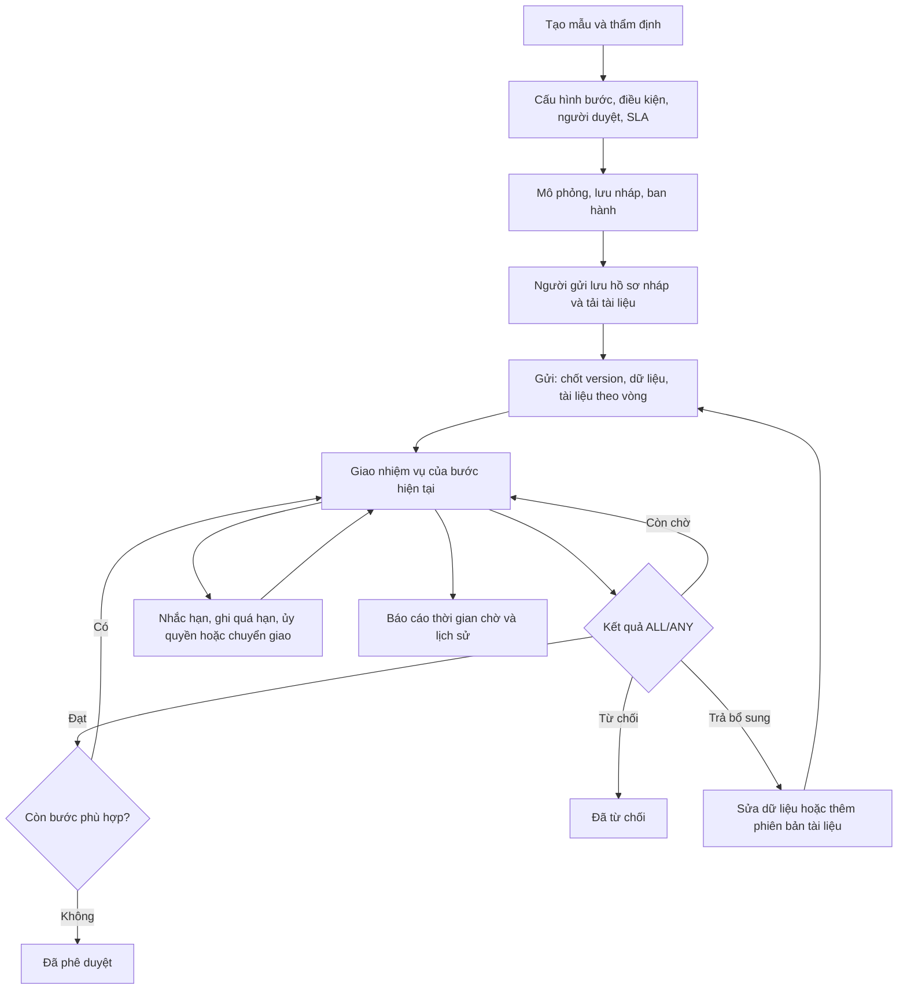

# Cách hoạt động của 12 chức năng quy trình

Tài liệu vận hành bản mở rộng ngày 01/10/2026. Mã 1–12 giữ đúng thứ tự danh sách đề xuất ban đầu. Chức năng 7–8 đã được tích hợp trong đợt sáu ưu tiên; đợt này bổ sung 9–12. Các ví dụ dùng một công ty demo, thời gian hiển thị theo múi giờ trình duyệt.

## Luồng chung

Trao đổi không thay thế quyết định; quá hạn không tự đồng ý. Thay đổi người xử lý không đổi phiên bản quy trình của hồ sơ.

## 1. Phê duyệt nhiều cấp — FR-01

- **Thao tác:** CDO vào **Quy trình**, thêm các bước theo thứ tự. Người gửi chọn mẫu và gửi yêu cầu.
- **Hoạt động:** Engine tạo nhiệm vụ cho bước đầu; chỉ khi bước đó đạt mới xét bước tiếp theo. Người ở bước sau chưa có nhiệm vụ thì chưa được duyệt.
- **Dữ liệu/kết quả:** `workflow_step_runs` lưu trạng thái, thời điểm bắt đầu/kết thúc; `approval_tasks` lưu từng người. Từ chối làm hồ sơ REJECTED, không chạy các bước tiếp.
- **Ví dụ:** Huy → Linh → CDO → CEO; xem từng bước tại **Tiến trình phê duyệt**.

## 2. Điều kiện dữ liệu — FR-02

- **Thao tác:** Chọn trường, toán tử, giá trị và ALL/ANY trong phần **Điều kiện chạy bước**.
- **Hoạt động:** ALL của điều kiện nghĩa là AND; ANY nghĩa là OR. Bước có điều kiện sai được ghi SKIPPED. Bước đầu luôn chạy để có người duyệt độc lập.
- **Dữ liệu/kết quả:** Lưu biểu thức trong definition, lưu giá trị thực tế/kết quả trong `condition_result`; vòng bổ sung đánh giá lại dữ liệu mới.
- **Ví dụ:** CP-MULTI dưới 10 triệu bỏ bước Chief; từ 10 triệu chạy bước Chief. NUMBER, DATE, CHECKBOX, SELECT được kiểm tra đúng kiểu; 0 và false không bị coi là trống.

## 3. Duyệt song song — FR-03

- **Thao tác:** Trong một bước, thêm nhiều người/quy tắc người duyệt và chọn ALL hoặc ANY.
- **Hoạt động:** ALL cần tất cả đồng ý, một từ chối kết thúc bước. ANY cần một đồng ý; một từ chối vẫn chờ người còn lại, tất cả từ chối mới kết thúc. Trả bổ sung luôn kết thúc vòng đang xử lý.
- **Dữ liệu/kết quả:** Mỗi người một task; khóa hàng hồ sơ ngăn hai quyết định đồng thời chuyển bước hai lần. Task còn chờ được hủy khi đã đủ kết quả.
- **Ví dụ:** CDO + CEO ALL ở CP-MULTI; CDO hoặc CEO ANY ở CP-ANY. Task gốc đã chuyển giao không còn được tính như một ghế cần đồng ý.

## 4. Tìm người duyệt — FR-04

- **Thao tác:** Chọn quản lý trực tiếp, quản lý cấp N, chức danh, phân công cụ thể, nhóm vai trò hoặc trưởng đơn vị; có thể giới hạn đơn vị.
- **Hoạt động:** Tìm phân công/tài khoản/chức danh/đơn vị đang hoạt động rồi kiểm tra quyền, phạm vi và tránh người gửi tự duyệt. Loại bỏ người trùng; tham chiếu mơ hồ cần cấu hình rõ hơn.
- **Dữ liệu/kết quả:** Chốt snapshot tên, chức danh và đơn vị ở task. Không tìm đủ người lúc gửi thì rollback; thiếu người khi chuyển bước thì BLOCKED, người vận hành sửa cơ cấu rồi **Thử lại**.
- **Ví dụ:** Hoàng thuộc bộ phận khác không xử lý thay Linh chỉ vì có role Approver.

## 5. Phiên bản quy trình — FR-05

- **Thao tác:** Sửa → lưu nháp → ghi chú ban hành → ban hành. Xem lịch sử, so sánh, phục hồi một version vào nháp.
- **Hoạt động:** Nháp có revision; sửa dữ liệu cũ trả 409. Version đã ban hành chỉ thêm mới. Hồ sơ pin version khi gửi lần đầu; gửi bổ sung vẫn dùng version đó.
- **Dữ liệu/kết quả:** `workflow_versions` bất biến; `workflow_instances.workflow_version_id` bất biến. Ban hành sau phục hồi tạo version mới.
- **Ví dụ:** Đơn A chờ Linh ở v1; CDO ban hành v2; đơn B dùng v2, A vẫn v1. SLA trong definition cũng theo version đã chốt.

## 6. Trả bổ sung — FR-06

- **Thao tác:** Người có nhiệm vụ chọn **Trả để bổ sung**, nhập lý do. Người gửi sửa nội dung, thêm tài liệu rồi gửi lại.
- **Hoạt động:** Hồ sơ RETURNED; task còn chờ bị hủy. Gửi lại tăng round, giữ mã, mẫu và version quy trình; chạy lại từ bước đầu, không tái dùng quyết định cũ.
- **Dữ liệu/kết quả:** Snapshot dữ liệu và danh sách tài liệu từng vòng bất biến; UI so sánh giá trị giữa hai vòng. Quyết định cũ vẫn có người và thời điểm.
- **Ví dụ:** Sửa 5 triệu thành 15 triệu tạo vòng mới đi thêm bước Chief; báo giá v1 ở vòng 1, v2 ở vòng 2.

## 7. Trình thiết kế trực quan — UX-01

- **Thao tác:** CDO vào **Quy trình**: chọn mẫu, thêm/xóa/đổi thứ tự các thẻ bước, chỉnh người duyệt, điều kiện, ALL/ANY và SLA.
- **Hoạt động:** UI dựng definition JSON; server validate giới hạn/cấu trúc/kiểu/tham chiếu trước khi ban hành. Sửa nháp chưa ảnh hưởng đơn đang chạy.
- **Kết quả:** Các thẻ cấu hình và sơ đồ tiến trình hồ sơ; có chế độ thẻ bước và canvas flow chọn node/pan/zoom/kéo bố trí; chưa có nối đồ thị/BPMN tùy ý. Xem [WORKFLOW_CANVAS.md](WORKFLOW_CANVAS.md).
- **Giới hạn:** 1–30 bước, 1–12 selector/bước, 20 điều kiện/bước, tối đa 50 người sau resolve.

## 8. Mô phỏng — UX-02

- **Thao tác:** Chọn người gửi, nhập dữ liệu thử ở **Mô phỏng** và chạy trước khi ban hành.
- **Hoạt động:** Dùng chung evaluator/resolver với engine; giải thích bước chạy/bỏ qua, người duyệt và lỗi. Lịch ủy quyền đang hiệu lực được xét cho người gửi thử; người thay không hợp lệ thì nêu cảnh báo và giữ người ban đầu.
- **Kết quả:** Không tạo Request, task, quyết định hay notification. Đây là dự đoán theo cơ cấu và lịch hiện tại; thời điểm gửi thật vẫn kiểm tra lại.
- **Ví dụ:** So sánh 5 triệu/15 triệu của Huy, rồi thử sender là CEO để thấy cấu hình tự duyệt hoặc thiếu quản lý.

## 9. Thời hạn, nhắc việc và chuyển cấp — FR-09

- **Thao tác:** Bật SLA ở từng thẻ bước, nhập hạn 1–43.200 phút, số phút nhắc trước hạn 0–hạn và người nhận chuyển cấp tùy chọn. Lưu/ban hành.
- **Hoạt động:** Khi bước bắt đầu, từng task có `due_at`, `remind_at`. Worker kiểm tra mỗi 30 giây, tối đa 200 hồ sơ/batch, bỏ qua hồ sơ đang bị khóa và chạy batch tiếp ở lần sau. Thời gian liên tục 24/7, chưa có lịch ngày nghỉ/giờ làm việc.
- **Nhắc hạn:** Một sự kiện REMINDER/task và notification đến người nhận. Đến hạn tạo OVERDUE/task, thông báo người nhận và người gửi; không tự từ chối/đồng ý.
- **Chuyển cấp:** Nếu cấu hình, tạo task thay thế cho người có quyền và độc lập; giữ hạn gốc. Người đích đã tham gia bước, bị khóa, sai scope hoặc tự duyệt thì ghi ESCALATION_FAILED, giữ task gốc. Người vận hành chuyển giao thủ công sau khi khắc phục; worker không lặp vô hạn lỗi đó.
- **Kết quả/quyền:** `sla_events` và audit; trang **Thời hạn & điểm chậm** có **Kiểm tra hạn ngay** cho `SLA_OPERATE` toàn công ty. Không dùng giờ giả từ client. Notifications hiện trong ứng dụng, chưa gửi email/SMS.
- **Thử:** Cấu hình hạn 1 phút, nhắc trước 1 phút, chọn CDO; Huy gửi và chờ khoảng 30–90 giây hoặc bấm kiểm tra. Tài khoản Linh thấy task chuyển cho CDO sau hạn.

## 10. Ủy quyền theo lịch và chuyển giao — FR-10

- **Thao tác:** Người có `TASK_DELEGATE` vào **Ủy quyền phê duyệt**, chọn người nhận, thời gian bắt đầu/kết thúc và lý do. Hoặc tại hồ sơ chọn nhiệm vụ, người nhận và **Chuyển giao**.
- **Ủy quyền:** Chỉ tạo lịch của mình; tối đa 90 ngày, không trùng lịch chưa thu hồi. Khi tạo task hoặc worker kiểm tra task cũ, lịch hiệu lực được áp dụng một lần, không tự nối chuỗi ủy quyền. Target phải có quyền thực tế với hồ sơ; lịch không cấp thêm quyền.
- **Chuyển giao:** Người được giao chuyển task của mình; `TASK_TRANSFER` cho phép chuyển task trong phạm vi quản trị. Hồ sơ và task được khóa cùng thứ tự với quyết định; task gốc CANCELLED, task mới PENDING, hạn gốc giữ nguyên, snapshot gốc không bị sửa.
- **Kết quả:** `task_transfers` ghi task trước/sau, người thao tác hoặc nguồn hệ thống, loại, lý do, lịch liên quan. Không nhận người đã có task ở cùng bước, tránh một người chiếm hai ghế ALL.
- **Thu hồi/hết hạn:** Dừng chuyển task tiếp theo; nhiệm vụ đã chuyển vẫn thuộc người nhận để không đổi người xử lý giữa chừng. Không khôi phục tự động; dùng chuyển giao nếu cần. Lịch không phù hợp giữ người gốc và thông báo.
- **Thử:** Linh ủy quyền CDO, Huy gửi → CDO có task; Linh không quyết định task cũ. Thu hồi lịch rồi Huy gửi đơn mới → Linh có task.

## 11. Tài liệu và trao đổi — FR-11

- **Thao tác:** Người gửi **Lưu bản nháp**, mở chi tiết → **Tài liệu hồ sơ**; chọn tệp mới hoặc phiên bản thay thế. Mọi người có quyền xem và `REQUEST_COMMENT` viết trao đổi trong phần bên cạnh.
- **Tài liệu:** Chỉ người gửi, chỉ DRAFT/RETURNED, cần `REQUEST_ATTACH`. Nhận PDF/PNG/JPEG/TXT/CSV, kiểm tra phần mở rộng/MIME/header hoặc UTF-8; 1 byte–2 MiB/tệp, tổng 20 MiB và 50 phiên bản/hồ sơ. Chưa quét antivirus hay xác thực toàn bộ cấu trúc PDF/ảnh; tải xuống dạng attachment với nosniff, không render nội dung tùy ý trong trang.
- **Lưu trữ:** Nội dung bytea, SHA-256 và metadata trong PostgreSQL, được Docker volume/pg_dump bảo toàn cùng DB. Tải tài liệu luôn kiểm tra quyền hồ sơ; không có link công khai.
- **Version/vòng gửi:** Khi submit, lưu các version mới nhất chưa gỡ vào `submission_attachments`. Thay thế tạo version mới cùng document_id. Gỡ là archive, không xóa nội dung hoặc snapshot vòng cũ; gỡ bản mới nhất không tự khôi phục bản cũ vào lần gửi tiếp theo.
- **Trao đổi:** Nội dung 1–2.000 ký tự, chỉ thêm mới; cả hồ sơ cuối vẫn trao đổi được. Thông báo cho người gửi và người có task pending, trừ chính người viết. Trao đổi không cập nhật revision dữ liệu và không chuyển bước.
- **Thử:** Báo giá v1 vòng 1 → Linh trả bổ sung → báo giá v2 vòng 2. Đăng nhập Hoàng ngoài phạm vi thử mở tài liệu phải bị từ chối.

## 12. Báo cáo điểm chậm — FR-12

- **Thao tác:** Người có `METRICS_VIEW` mở **Thời hạn & điểm chậm**, chọn khoảng ngày tối đa 366 ngày, bấm áp dụng/làm mới.
- **Tập dữ liệu:** Chọn StepRun có entered_at trong `[from,to)`, bỏ SKIPPED; giới hạn cả quyền báo cáo và quyền nhìn hồ sơ. Mỗi vòng bổ sung là một lượt mới. Không lấy số mẫu của tài liệu/notification làm số hồ sơ.
- **Chỉ số:** Thời gian lượt bước = completed_at − entered_at nếu kết thúc, hoặc now − entered_at nếu còn ACTIVE. Trung bình/p95 chỉ dùng lượt đã kết thúc; chờ lâu nhất chỉ dùng ACTIVE. Đếm lượt trả bổ sung, đang chờ và có vi phạm hạn.
- **SLA:** Một bước có vi phạm nếu bất kỳ task nào quyết định/kết thúc sau due_at hoặc còn chờ quá hạn; bao gồm task đã chuyển để không che mất quá hạn trước chuyển giao. Tỷ lệ đúng hạn = lượt APPROVED/REJECTED/RETURNED có SLA và không vi phạm / tất cả lượt kết thúc tương ứng có SLA; CANCELLED không trong mẫu tỷ lệ.
- **Kết quả:** Nhóm theo tên mẫu + step_id + tên bước; UI hiển thị số mẫu để đọc p95 đúng ngữ cảnh; tối đa 100 nhóm và 50 bước đang chờ lâu nhất, có link hồ sơ. Đây là báo cáo tại thời điểm truy vấn, chưa phải kho phân tích hay dashboard realtime.
- **Thử:** CDO xem tổng công ty; Hoàng chỉ thấy lượt thuộc hồ sơ và phạm vi được phép, không được nhận dữ liệu phòng khác.

## Quyền và chốt dữ liệu

| Quyền mới | Mặc định cấp | Ràng buộc bổ sung |
|---|---|---|
| TASK_DELEGATE | Role có REQUEST_APPROVE | Lịch của mình; chuyển task của mình; kiểm tra target theo hồ sơ |
| TASK_TRANSFER | SYSTEM_ADMIN/WORKFLOW_MANAGER/FORM_PUBLISHER | Scope của người gửi hồ sơ |
| SLA_OPERATE | SYSTEM_ADMIN/WORKFLOW_MANAGER/FORM_PUBLISHER | Toàn công ty |
| METRICS_VIEW | Các role quản trị trên + APPROVER | Giao của phạm vi báo cáo và visibility hồ sơ |
| REQUEST_COMMENT/REQUEST_ATTACH | Role có REQUEST_CREATE | Comment phải xem được hồ sơ; attach phải là chủ và DRAFT/RETURNED |

Chức danh không tự cấp permission. Cấp role hoặc scope qua **Vai trò & quyền**; snapshot tại thời điểm giao việc không thay thế kiểm tra quyền tại lúc quyết định.

## Đường dẫn kỹ thuật và kiểm chứng

- SQL: `006_workflow_operations.sql`; schema Prisma đồng bộ migration 001–006.
- Runtime: `workflow-engine.ts`, `task-operations.ts`, `operations.ts`; worker nằm trong API, khởi động lại vẫn đọc hạn/lịch từ DB. Có thể tắt bằng `SLA_WORKER=false`; môi trường kiểm thử tắt timer và gọi job chủ động.
- UI: `workflow-pages.tsx`, `workflow-progress.tsx`, `operations-pages.tsx`.
- Ca tự động: `backend/tests/workflow-operations.mjs`; xem actual ở [TESTING.md](TESTING.md). UAT trực quan/mobile/A4 cần sinh viên thử và ghi vào [UAT.md](UAT.md).
