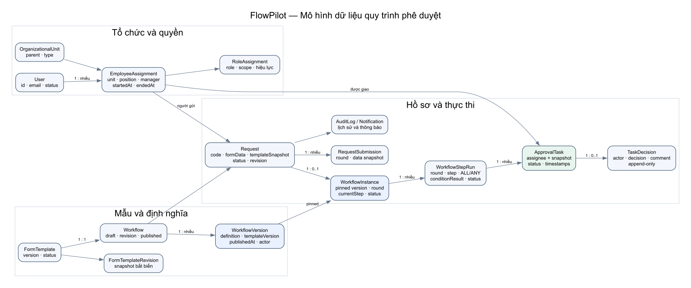
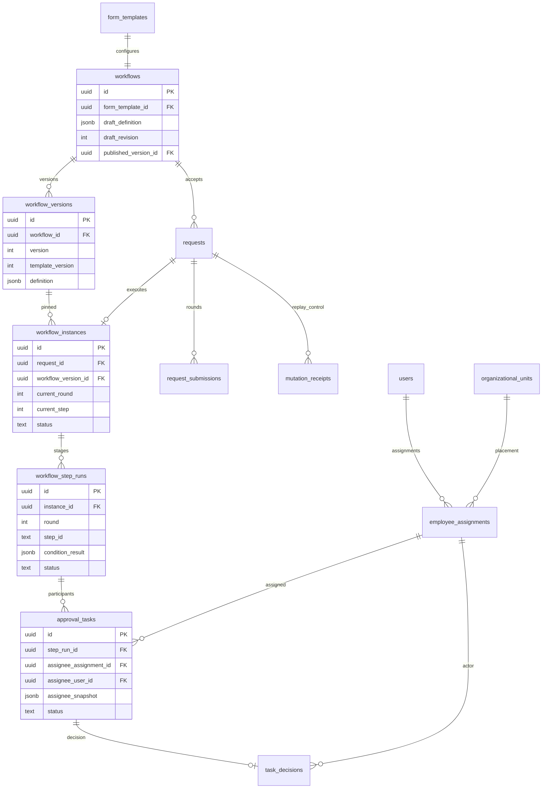
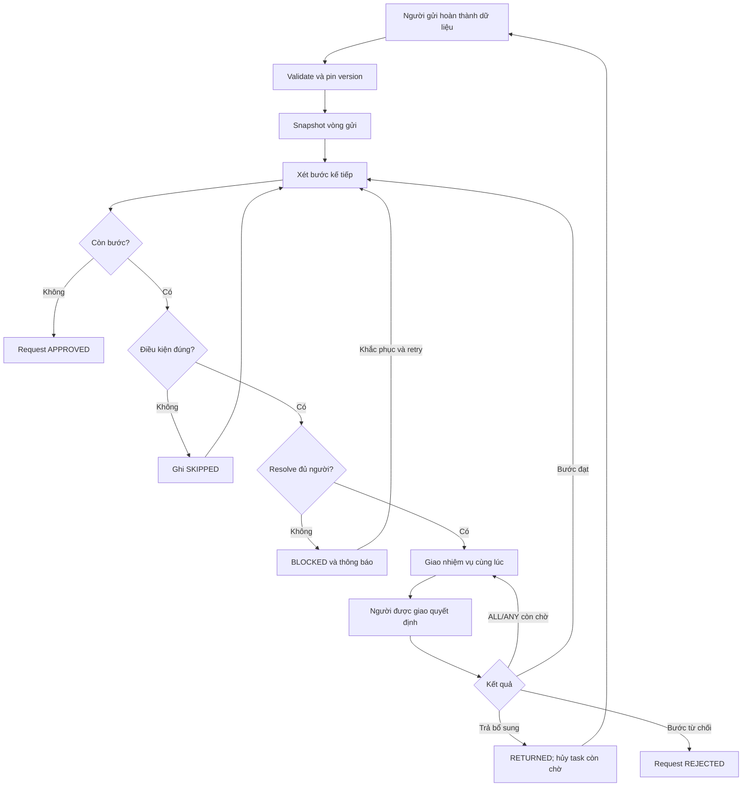
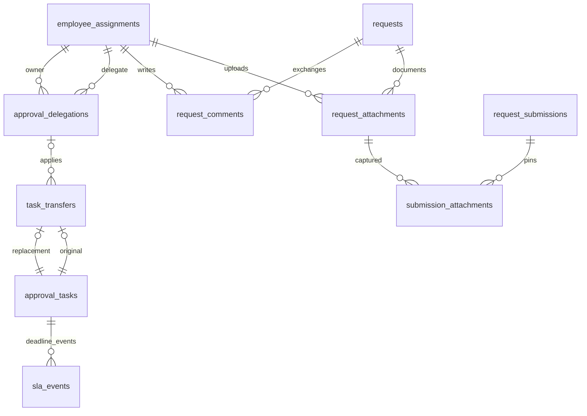

# Sơ đồ quy trình và dữ liệu

Mô hình hiện thực ngày 01/10/2026. Class diagram đầy đủ: [ClassDiagram.puml](ClassDiagram.puml). Definition gồm bước tuần tự có điều kiện; runtime ghi StepRun, task và round.

## Tổng quan lõi sáu chức năng (trước phần vận hành)

[SVG](diagrams/workflow-model.svg) · [source Graphviz](diagrams/workflow-model.dot)

## ERD phần nâng cấp

## Activity xử lý

Khi quay từ RETURNED sang gửi lại: tăng round, giữ mã/template snapshot/workflow version và chạy từ bước đầu. Thiếu người ở preflight lần gửi đầu rollback; BLOCKED dành cho sự thay đổi ứng viên khi chuyển bước sau đó.

## ERD vận hành CR-02

Task thay thế tiếp tục cùng StepRun và kế thừa due_at; from task CANCELLED, được bỏ khỏi số ghế ALL/ANY nhưng giữ lịch sử. Snapshot round chốt version tài liệu bằng join; nội dung bytea không sửa. Xem WORKFLOW_GUIDE.md và ClassDiagram.puml (đã gồm lớp vận hành).
